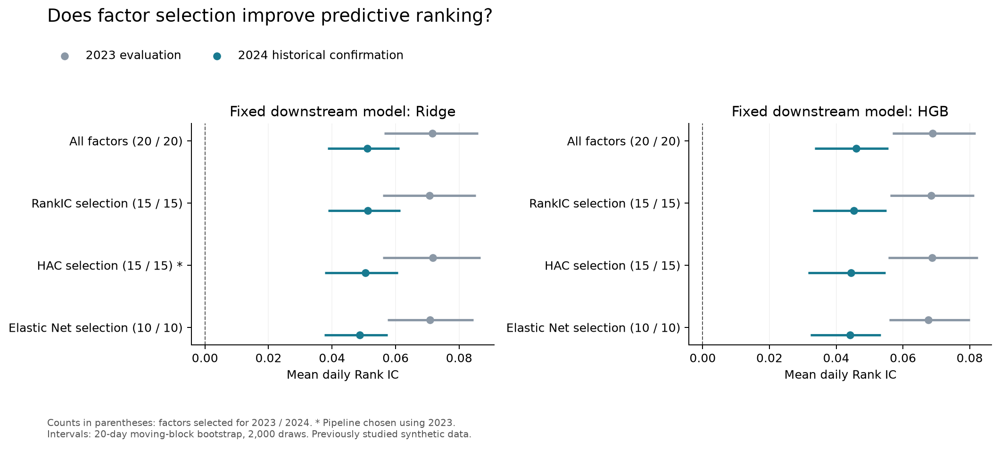
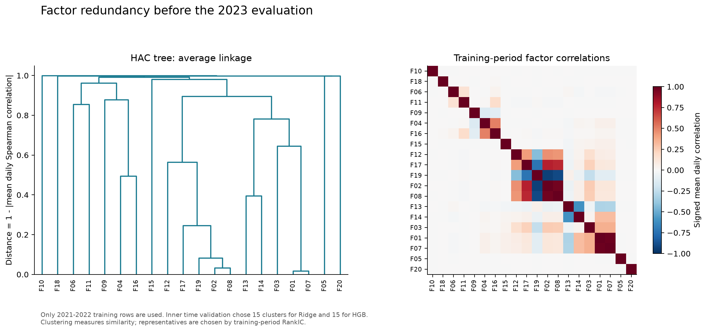
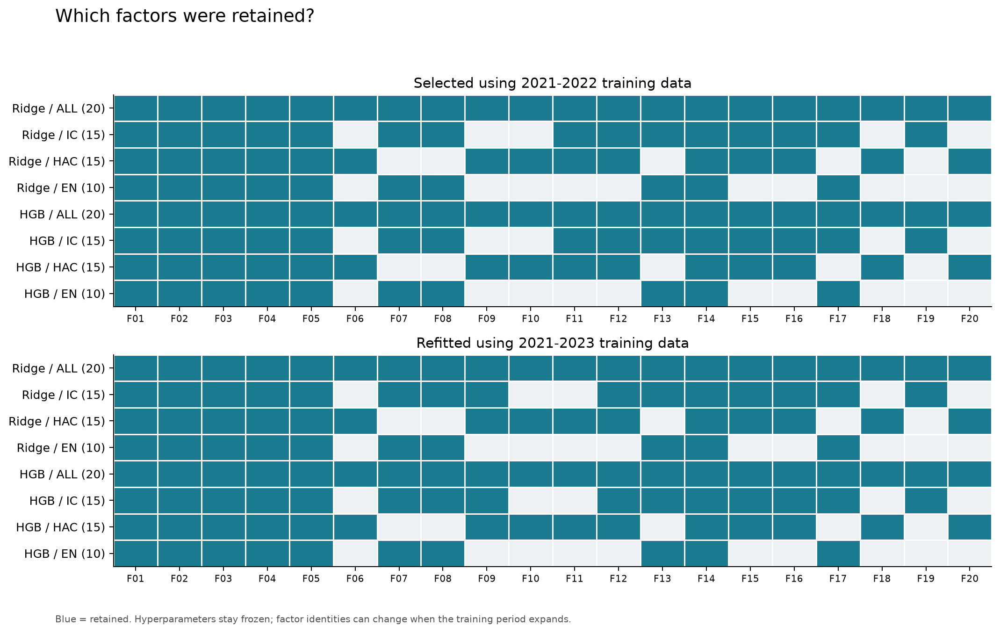

# HAC 与 Elastic Net 因子筛选研究

研究日期：2026 年 10 月 11 日。输入为 Alpha Forensics v1.0 已完成可用时点修正的匿名合成因子面板。

**本轮没有获得因子筛选稳定超越全部 20 个因子基准的证据。** 按 2023 年规则预选的“HAC 保留 15 因子＋Ridge”，在 2024 年平均 RankIC 为 0.050451，略低于全因子 Ridge 的 0.051048，配对差值参考区间跨过零。另一项有用结果是：同样只保留 10 个因子时，Elastic Net 的联合筛选明显优于按单因子 RankIC 取前 10 个，但仍未超过全因子基准。

## 研究问题与固定对照

前一轮更换预测模型时，全部模型都使用相同的 20 个因子。本轮固定下游模型为 Ridge 和 HGB，检验因子筛选本身的增量，并区分“减少输入数量”和“选择不同因子”的影响。

四条主要流程为：全部 20 因子；按绝对平均日 RankIC 选前 k 个；HAC 聚成 k 簇并各选一个代表；Elastic Net 选择非零系数对应的原因子。每条流程分别接 Ridge 和 HGB。另为 HAC 和 Elastic Net 各设同数量的 RankIC 筛选辅助对照；这些辅助组不参与最终候选选择。流程重复选出相同因子时，保留身份和重复标记，不视为额外独立方法。

下游参数保持上一轮不变：Ridge alpha=100，训练期特征标准化；HGB 55 轮、学习率 0.065、17 叶、L2=0.2、种子 1021，关闭随机内部早停。所有模型使用训练期中位数补齐缺失，不额外调整模型参数。

## 筛选方法

**RankIC 排序。** 在每个训练窗口内，先拟合缺失值填补，再逐日计算每个因子与未来五日收益的截面 Spearman 相关。以日度相关的等权均值取绝对值排序；精确平局时，优先选择训练季度方向一致率更高的因子，再按编号排序。负向预测关系允许保留，方向由下游模型学习；这里没有对评价期预测事后翻转方向。

**HAC。** 聚类对象为 20 个因子。每天计算截面因子 Spearman 相关矩阵，跨日等权平均后定义距离 `D = 1 - abs(mean_daily_correlation)`，使用平均连接法和 `cut_tree` 切成指定数量的簇。每簇按上述同一 RankIC 排名选一个代表。每日相关未定义时保留缺失，记录有效天数后求均值；不把未定义相关填成零。方法依据见 [相关特征聚类示例](https://scikit-learn.org/stable/auto_examples/inspection/plot_permutation_importance_multicollinear.html)与 [SciPy cut_tree](https://docs.scipy.org/doc/scipy/reference/generated/scipy.cluster.hierarchy.cut_tree.html)。本实验使用平均连接法，未采用 Ward。

**Elastic Net。** 在训练窗口内补齐并标准化 20 个特征，同时标准化目标收益，拟合 L1 比例为 0.5 的 Elastic Net。保留系数不等于零的原因子，再由 Ridge 或 HGB 重新拟合预测模型。筛选器的最大迭代次数为 5,000、容差为 1e-5；空集合或不收敛配置明确记为不可选，不换成其他因子。参考 [ElasticNet 参数说明](https://scikit-learn.org/stable/modules/generated/sklearn.linear_model.ElasticNet.html)。

## 时间验证和运行前冻结

筛选参数只在 2021—2022 年内部选择。内部验证为 2022 年四个季度的扩展训练窗：每折用此前已成熟标签的样本重新计算填补值、因子排名、HAC 结构、Elastic Net 系数和下游模型，再评价该季度。训练标签终点严格早于该季度首个合成交易日，验证标签终点早于下一季度首个合成交易日；第四季度不使用 2023 年价格。

预先固定 IC/HAC 的候选数量为 5、10、15；Elastic Net alpha 为 0.001、0.01、0.05。每个筛选方法、每种下游模型，按四折合并后每天等权的预测 RankIC 选择参数。一个参数必须具有完整四折有效结果，不能跳过失败折后再平均。

内部结果对两个下游模型均选出 IC k=15、HAC k=15、Elastic Net alpha=0.05。20 个“选择器配置＋下游模型”组合均有完整四折证据，实际完成 80 次下游拟合，没有空集或收敛失败配置。

随后使用与上一轮模型比较完全相同的外层样本：

| 阶段 | 训练行数 | 评价行数与日期 | 用途 |
|---|---:|---:|---|
| 2023 年 | 192,806 | 99,057 行，254 日 | 比较八条主要流程并按预定 RankIC 规则选一条 |
| 2024 年 | 294,192 | 97,929 行，256 日 | 固定流程的追加历史复核 |

2023 年选择“HAC 15＋Ridge”，之后只将训练期扩展至 2021—2023 年重新估计筛选器和模型。k、alpha、筛选规则与下游参数保持不变；允许因子名单随训练数据更新，并在评价前保存。该候选在 2023 年相对全因子 Ridge 的 RankIC 增量仅 0.000148，95% 参考区间 [-0.001073, 0.001003]，当时的领先也很小。

运行前协议、内部参数选择、2023 候选选择分别独立冻结。三阶段源码、数据、依赖和前序结果通过哈希串联。整份数据及 2024 年结果此前已经被研究过，因此本轮属于追加历史研究，不能重新称为未接触数据上的独立盲测。

## 实际结果

| 下游模型 | 筛选方法 | 因子数 | 2023 平均 RankIC | 2024 平均 RankIC | 2024 五日毛分组差 |
|---|---|---:|---:|---:|---:|
| Ridge | 全部因子 | 20 | 0.071504 | 0.051048 | 0.6390% |
| Ridge | RankIC 排序 | 15 | 0.070685 | 0.051229 | 0.6401% |
| Ridge | HAC 分簇选代表 | 15 | 0.071652 | 0.050451 | 0.6318% |
| Ridge | Elastic Net 非零系数 | 10 | 0.070789 | 0.048766 | 0.6116% |
| HGB | 全部因子 | 20 | 0.068826 | 0.045993 | 0.6907% |
| HGB | RankIC 排序 | 15 | 0.068407 | 0.045266 | 0.6715% |
| HGB | HAC 分簇选代表 | 15 | 0.068687 | 0.044463 | 0.6612% |
| HGB | Elastic Net 非零系数 | 10 | 0.067642 | 0.044158 | 0.6243% |

2024 年六条筛选流程相对各自全 20 因子基准的配对 RankIC 差值区间都包含零。预选的 HAC 15＋Ridge 相对全因子 Ridge 的增量为 **-0.000598**，区间 **[-0.002130, 0.000983]**；五日毛分组差为 0.6318%，对照为 0.6390%。目前没有支持替换全因子基准的稳定增益证据。

2024 年点估计最高的是 IC 15＋Ridge，但增量仅 0.000181，区间 [-0.000198, 0.000605]。本轮保留 2023 年预选记录，不根据已看到的 2024 年结果重新改选。

八条主要流程在两年中的收益幅度预测均未胜过训练均值常数基准：相对该基准的 R² 全为负。2024 年常数基准 RMSE 为 0.043404，HAC 15＋Ridge 为 0.043474，Elastic Net 10＋Ridge 为 0.043484。分组差是未来五日毛收益的诊断，未涉及持仓资金、交易执行或成本。



## 同数量比较与因子名单

| 下游模型 | 同数量对照 | 2024 配对 RankIC 增量 | 95% 参考区间 |
|---|---|---:|---|
| Ridge | HAC 15 − IC 15 | -0.000779 | [-0.002184, +0.000527] |
| Ridge | Elastic Net 10 − IC 10 | +0.006992 | [+0.005534, +0.008816] |
| HGB | HAC 15 − IC 15 | -0.000803 | [-0.002712, +0.001100] |
| HGB | Elastic Net 10 − IC 10 | +0.006012 | [+0.004668, +0.007687] |

同样保留 15 个因子，HAC 对 RankIC 排序没有明确增量。同样保留 10 个因子，Elastic Net 则在两个下游模型中都优于 RankIC Top 10。2024 年 Ridge 对应均值分别为 **0.048766 与 0.041775**，HGB 为 **0.044158 与 0.038146**；两种下游模型的尾部分组差配对区间也均高于零。2023 年对应的排序增量区间同样高于零。

Elastic Net 在 2023、2024 两次外层训练中均保留以下 10 个因子，且两个下游模型使用相同名单：

`factor_01, factor_02, factor_03, factor_04, factor_05, factor_07, factor_08, factor_13, factor_14, factor_17`

与 IC Top 10 相比，差别是保留 `factor_05`、`factor_13`，未保留 `factor_12`、`factor_19`。这是联合筛选与单因子排名产生不同结果的具体证据；若继续研究，可用预先规定的替换消融检验这两组因子的贡献，不能仅由本轮结果将全部增量归于其中某一个因子。

HAC 两次外层训练的 15 簇及代表名单保持一致。三个非单元素簇为 `{01,07}`（代表 01）、`{02,08,17,19}`（代表 02）、`{13,14}`（代表 14），其余因子各自成簇。因此 HAC 保留 15 个、移除 07、08、13、17、19。该分组反映相关结构，不能由匿名编号推断经济含义。





## 研究判断

继续保留全 20 因子作为预测基准。本次固定候选网格没有证明筛选能够稳定提升其排序表现；HAC 分组清楚地展示了相关因子，但去冗余没有自动转化成更强预测。

如果研究目标另包含压缩输入维度，Elastic Net 的 10 因子方案值得保留为候选：它在相同数量下优于单因子排名法。其相对全因子基准仍有性能损失的点估计，区间跨零不构成“效果完全等价”的证明。

主要结果使用相同日期配对、连续 20 个交易日的移动区块 bootstrap，共 2,000 次抽样。区间未作多模型比较校正，属于已被研究过的历史合成数据上的条件性证据。评价面板保留的是标签终点可观察的成员资产；本轮不据此评价退出后缺价格样本，也不推断可交易净收益。

## 复现与证据

本轮复用现有 Python 环境，没有新增依赖；完整版本位于 `requirements-models.txt`。从工作区根目录执行，使用新输出目录保留现有证据：

```bash
asset_allocation/.venv_models/bin/python -B -m unittest discover -s asset_allocation -p 'test_factor_selection_study.py' -v
OMP_NUM_THREADS=4 OPENBLAS_NUM_THREADS=1 MKL_NUM_THREADS=1 asset_allocation/.venv_models/bin/python -B asset_allocation/factor_selection_study.py --stage tune --out asset_allocation/outputs/factor_selection_reproduction
OMP_NUM_THREADS=4 OPENBLAS_NUM_THREADS=1 MKL_NUM_THREADS=1 asset_allocation/.venv_models/bin/python -B asset_allocation/factor_selection_study.py --stage validation --out asset_allocation/outputs/factor_selection_reproduction
OMP_NUM_THREADS=4 OPENBLAS_NUM_THREADS=1 MKL_NUM_THREADS=1 asset_allocation/.venv_models/bin/python -B asset_allocation/factor_selection_study.py --stage confirmation --out asset_allocation/outputs/factor_selection_reproduction
MPLCONFIGDIR=/tmp/factor_selection_mpl asset_allocation/.venv_models/bin/python -B asset_allocation/plot_factor_selection.py --out asset_allocation/outputs/factor_selection_reproduction
```

16 项新增契约测试通过。内部选择、2023 比较、2024 复核三阶段分别约用 23.77、10.37、13.12 秒，合计约 47 秒，不含实现、审查和作图。两外层阶段各实际拟合 12 个流程，其中 4 个为辅助对照；全流程共完成 104 次下游模型拟合，另有 Elastic Net 筛选器拟合。

| 证据 | `outputs/factor_selection_study/` 下的位置 |
|---|---|
| 运行前协议 | `protocol.json` |
| 内部选择与候选参数 | `tuned_selectors.json`、`tune/inner_candidate_scores.csv` |
| 四折完整证据 | `tune/2022Q*/`、`tune/inner_scores.csv`、`tune/inner_daily_metrics.csv` |
| 2023 固定候选 | `chosen_pipeline.json` |
| 各阶段共同样本与选中因子 | 阶段目录内 `split_manifest.json`、`selected_factors.json` |
| 因子 IC、相关、距离与聚类 | 阶段目录内 `common_statistics/` |
| 逐行预测、拟合与统计 | 阶段目录内 `*_predictions.csv.gz`、`*_fit_metadata.json`、`summary.csv` |
| 同数量配对比较 | 阶段目录内 `matched_comparisons.csv` |
| 季度和五日起点诊断 | 阶段目录内 `quarterly.csv`、`phases.csv` |
| 完成状态及完整性校验 | 各阶段 `run_manifest.json`、根目录 `verification.json` |
| 三套图表 | `selection_comparison.*`、`hac_structure.*`、`selected_factor_map.*`、`plot_manifest.json` |

执行与测试日志位于 `outputs/factor_selection_logs/`。原始数据、上一轮模型比较代码和产物保持原样。方法与开源来源另见 [方法说明](method_sources.md)。
