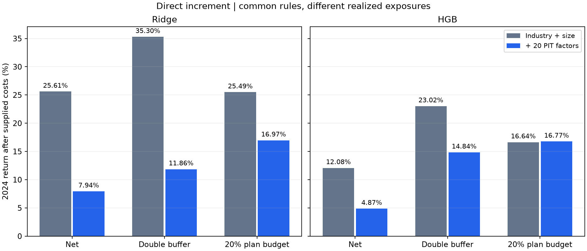
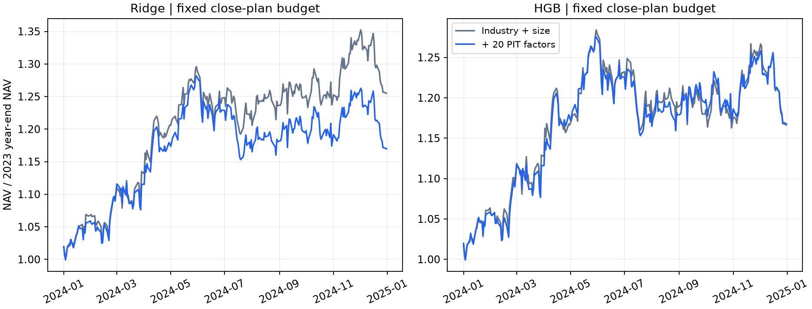

# 行业、市值基础上加入20因子的直接增量实验

研究日期：2026-10-11。数据为题包 Alpha Forensics Candidate v1 的匿名合成资产。正式计算及独立复核均已完成。

## 1. 结论

**本次直接加入因子后，仍未得到稳定的成本后收益增量。** 20个因子确实提供了一些预测信息：2023年两种模型的排序增量都较清楚，2024年HGB的排序增量参考区间也为正。但主模型Ridge在三种固定交易规则下的2024年净收益都落后于行业市值基准；HGB在固定计划预算下基本持平，没有明确的净收益增量。

预先固定的主交易对照为2024年、题包成本、BUDGET20的Ridge。联合模型收益 **16.97%**，简单基准 **25.49%**，相差 **−8.52个百分点**。同日算术收益差为 **−2.686基点/日**，95%参考区间 **[−5.562, −0.033]**；区间上端接近零，应连同历史样本及未作多项比较校正的边界解释。相同组的HGB为 **16.77% 对16.64%**，净值点估计接近，日收益差区间跨零。

因此，应降低“把20因子整体加入模型即可改善交易”的研究优先级，保留简单基准。联合模型可作为候选和研究对照；本次结果不能判定每一个因子都没有信息，也没有完成逐因子贡献检验或风险中性的收益归因。

## 2. 比较设计与样本

这次比较明确为：

- **CONTROLS**：行业完整哑变量＋市值自然对数。
- **JOINT**：上述同一组控制变量＋全部20个可用时点修正后的匿名因子。

Ridge为主模型，HGB为对照。模型参数沿用既有研究：Ridge alpha=100；HGB 55轮、学习率0.065、17叶、L2=0.2、关闭内部早停、随机种子1021。因子缺失使用训练期中位数；Ridge整个设计矩阵用训练期均值和标准差缩放。没有选择新参数、因子数量或预算值。

2023年用2021—2022年训练，2024年用2021—2023年训练；训练标签终点必须早于评价期首个信号日。两套模型的训练键、标签、成员池完全一致。四个既有控制模型和完整预测原样复用并核对，只新增四次联合模型拟合。

| 评价年份 | 成熟训练行 | 标签诊断行 | 诊断日期 | 完整交易信号行 | 交易信号日期 | 缺完整未来标签的信号 |
|---|---:|---:|---:|---:|---:|---:|
| 2023 | 192,806 | 99,057 | 254 | 101,397 | 260 | 4 |
| 2024 | 294,192 | 97,929 | 256 | 100,265 | 262 | 2,336 |

2023年标签诊断另排除收益终点进入2024年的记录，所以诊断行数不等于完整信号行数减缺失标签数。实际交易始终保留当时全部成员，不用未来收益可观察性筛股票。2024年年度收益承接2023年末现金与持仓，按2023年末净值为起点计算。

行业、市值沿用信号日盘后可知的研究假设；题包没有单独发布时点记录。所有年度数据之前已经用于研究，本轮属于追加历史实验。

## 3. 预测增量

| 年份 | 模型 | 行业市值 RankIC | 加入20因子 RankIC | 配对增量 | 95%参考区间 |
| --- | --- | --- | --- | --- | --- |
| 2023 | Ridge | 0.025593 | 0.072963 | +0.047370 | [0.035522, 0.063097] |
| 2023 | HGB | 0.017901 | 0.066573 | +0.048671 | [0.037280, 0.062052] |
| 2024 | Ridge | 0.038976 | 0.051361 | +0.012385 | [-0.002701, 0.029055] |
| 2024 | HGB | 0.028547 | 0.046243 | +0.017696 | [0.002457, 0.035160] |

2024年Ridge的排序增量区间跨零，HGB的区间为正。2024年五日高低组毛收益差的增量分别为Ridge **0.2736个百分点**、HGB **0.3961个百分点**，参考区间分别为 **[0.0229, 0.5422]** 和 **[0.1346, 0.6990]个百分点**。这些是重叠未来五日标签的截面诊断，不是账户日收益。

收益幅度预测没有同步改善。2024年Ridge的整体RMSE由 **0.043387** 升至 **0.043479**；日度RMSE配对增量约 **0.000098**，区间 **[0.000041, 0.000148]** 为正，表示误差增加。HGB整体RMSE由 **0.043441** 升至 **0.043478**，日度误差增量区间跨零。不能把排序改善解释为涨跌幅预测同步改善。

## 4. 固定交易规则与主期净收益

四个预测器分别运行三种规则和三档成本，共 **36个实际账户**。沿用做多、不借款、五份资金轮换、前10%入选、临界并列一并保留、盘后冻结目标、次日开盘、前日许可与费用、受阻买入预算留现金、缺报价零回收等原有契约。

| 规则 | 本轮固定方法 |
|---|---|
| NET | 原净额规则；仅交易目标与实际股数差额 |
| BOTH | 前10%入场、前20%已有仓续持，同时使用目标权重上下10%的相对缓冲 |
| BUDGET20 | NET理想目标，按真实收盘持仓插值；每份资金每次调整计划双边交易不超过该份收盘净值的20% |

BUDGET20只固定一个预算，初始建仓也受限制，末尾清仓豁免。若实际权重为w、理想权重为u，先算D=Σ|u−w|，再按λ=min(1,0.20/D)形成w+λ(u−w)；D为零时不缩放。开盘跳空、买入费用缩放和受阻卖单重试可能改变实际成交额，**不能把计划上限称为实际换手严格上限**。

下表为2024年题包成本结果。收益差以年度收益率的百分点表示；配对均值和区间以基点/日表示，两者口径不同。

| 规则 | 模型 | 行业市值净收益 | 加入20因子净收益 | 年度差（百分点） | 日收益差（基点） | 95%参考区间（基点） |
| --- | --- | --- | --- | --- | --- | --- |
| NET | Ridge | 25.61% | 7.94% | -17.66 | -5.779 | [-9.353, -2.586] |
| NET | HGB | 12.08% | 4.87% | -7.20 | -2.566 | [-6.795, 0.721] |
| BOTH | Ridge | 35.30% | 11.86% | -23.44 | -7.236 | [-10.261, -4.357] |
| BOTH | HGB | 23.02% | 14.84% | -8.19 | -2.660 | [-6.195, 0.195] |
| BUDGET20 | Ridge | 25.49% | 16.97% | -8.52 | -2.686 | [-5.562, -0.033] |
| BUDGET20 | HGB | 16.64% | 16.77% | +0.13 | -0.006 | [-2.650, 2.702] |



Ridge在三个规则下均落后，日收益差参考区间均低于零；BUDGET20的区间上端仅略低于零。HGB的NET和BOTH点估计为负、区间跨零，预算组接近持平。HGB预算组累计收益略高，而平均日算术收益差约为零略负，是日收益分布和复利路径不同造成的；日对数相对增长参考区间同样跨零。



## 5. 换手、现金与风险敞口

| 规则 | 模型 | 基准日均双边换手 | 联合日均双边换手 | 基准平均现金 | 联合平均现金 |
| --- | --- | --- | --- | --- | --- |
| NET | Ridge | 2.27% | 25.81% | 1.22% | 2.45% |
| NET | HGB | 8.00% | 25.17% | 1.31% | 2.07% |
| BOTH | Ridge | 0.64% | 17.72% | 2.27% | 2.27% |
| BOTH | HGB | 3.16% | 16.67% | 2.84% | 1.83% |
| BUDGET20 | Ridge | 2.21% | 4.28% | 1.23% | 1.84% |
| BUDGET20 | HGB | 4.28% | 4.28% | 1.30% | 1.59% |

固定预算将联合模型的实际日均双边换手压至约 **4.28%**。HGB基准和联合模型的实际换手几乎相同，净收益仍基本持平；Ridge基准只需要约 **2.21%** 换手，没有用满同一预算，联合模型仍落后。相同预算上限没有使Ridge两组的实际换手相等。

2024年每个预算账户有256次普通检查。两个联合模型和HGB基准全部256次预算约束生效；Ridge基准仅16次。预算方案的持仓逐步调整，会留下很多小仓位：联合模型平均有约366—376个正持仓，不能理解为等权持有这么多资产。以下集中度合并同资产跨资金份仓位后计算。

| 模型 | 输入 | 平均HHI | 年化波动 | 权益加权规模z值 | 行业偏离L1 |
| --- | --- | --- | --- | --- | --- |
| Ridge | CONTROLS | 0.0249 | 17.08% | -1.482 | 0.544 |
| Ridge | JOINT | 0.0064 | 17.07% | -0.427 | 0.221 |
| HGB | CONTROLS | 0.0200 | 17.80% | -0.840 | 0.623 |
| HGB | JOINT | 0.0070 | 17.11% | -0.236 | 0.223 |

规模z值以当日成员的log市值均值和标准差标准化，再按权益持仓加权；负值代表小市值倾向。行业偏离L1为各行业权益权重相对成员等权行业占比的绝对差之和。全部现金日的权益归一指标记为未定义，另报告现金占比，不补成零。

联合模型的行业和小市值偏离更弱、集中度更低。**本轮控制的是相同持仓约束与计划换手预算，没有强制两组行业、市值和实际风险完全一致。** 所以本轮可以评价固定交易流程中的新增因子价值，不能把全部净收益差解释成相同风险暴露下的纯因子收益。

## 6. 成本压力与跨年描述

| 规则 | 模型 | 零成本基准 | 零成本联合 | 两倍成本基准 | 两倍成本联合 |
| --- | --- | --- | --- | --- | --- |
| NET | Ridge | 28.00% | 31.67% | 23.26% | -11.48% |
| NET | HGB | 18.71% | 29.04% | 5.85% | -14.73% |
| BOTH | Ridge | 36.02% | 28.42% | 34.58% | -2.55% |
| BOTH | HGB | 25.73% | 32.33% | 20.37% | -0.30% |
| BUDGET20 | Ridge | 27.83% | 20.88% | 23.21% | 13.18% |
| BUDGET20 | HGB | 20.35% | 20.94% | 13.05% | 12.72% |

成本是重要原因，但不是全部。Ridge预算组即使零成本，联合模型 **20.88%** 仍低于基准 **27.83%**；双缓冲零成本也为 **28.42% 对36.02%**。HGB预算组零成本略领先，两倍成本略落后，均不构成稳定优势。

下表为已查看历史的分期描述，不作为新增独立验证。FULL是两年复利累计收益。

| 规则 | 模型 | 2023基准 | 2023联合 | 两年基准累计 | 两年联合累计 |
| --- | --- | --- | --- | --- | --- |
| NET | Ridge | 72.46% | 65.01% | 116.62% | 78.11% |
| NET | HGB | 56.30% | 59.40% | 75.18% | 67.17% |
| BOTH | Ridge | 83.99% | 72.02% | 148.94% | 92.41% |
| BOTH | HGB | 65.77% | 65.36% | 103.93% | 89.89% |
| BUDGET20 | Ridge | 84.92% | 79.91% | 132.06% | 110.44% |
| BUDGET20 | HGB | 80.98% | 78.20% | 111.09% | 108.08% |

2023年净额HGB联合模型略优，其余五组均未优于基准；两年累计六组联合模型均低于相应简单基准。不能只从其中一年的排序增量推出跨年的交易价值。

## 7. 统计、核验与复现

主比较在读取本轮结果前写入 `outputs/joint_factor_increment/protocol.json`：2024年、题包成本、BUDGET20、Ridge JOINT减CONTROLS。NET/BOTH、HGB、2023年以及0倍/2倍成本为对照。预测与交易差值均按同日配对，使用20日移动区块、2,000次重采样、种子1021；区间未作多项比较校正。没有根据结果改变模型、预算或候选规则。

43项相关测试全部通过。新增预算仅扩展NET的可选调用；原八种无预算政策在含跳空、费用和受阻的测试场景中与修改前逐表一致。12个正式无预算控制账户与既有账户再次逐日核对，最大净值差约 **4.44×10⁻¹⁶**。正式运行约 **105秒**，完整源快照保存在 `source_snapshot/`。

**独立核验状态：全部通过。** 从原始因子发布日期独立重建PIT输入，核验成熟标签边界和训练期预处理，重新拟合四个联合模型，最大预测误差约 **1.15×10⁻¹⁴**。独立复算8条预测汇总、12条预测配对、2,040条日度预测统计和72条组合配对区间。

36个账户合计核对 **1,768,092次订单尝试、1,754,777笔成交**，逐项检查资金、库存、净值、前日费用与权限、收盘计划、开盘股数、受阻订单和终末退出。12个预算账户的每次计划均通过独立预算与缩放核验。最大现金重建误差约 **1.98×10⁻¹²**，最大净值重建误差约 **2.06×10⁻¹²**。核验约5分钟；完整记录为 `verification.json`。

另列的风险敞口与预算汇总表不属于逐表独立复算范围，其计算通过小样本契约测试；核心持仓和逐条预算计划已独立检查。核验确认实现与统计可追溯，独立新样本仍未取得。

旧版账本和旧版审计源码保存在 `outputs/joint_increment_legacy_sources/`，已核对其哈希与上一轮冻结记录一致。原模型、原始数据和历史结果不覆盖。旧冻结记录中的代码哈希对应这些旧版快照；当前两个源码已增加预算支持，直接拿当前文件校验旧版本哈希会报版本不一致。

在工作区根目录复现，输出目录必须尚不存在：

```bash
PYTHONPATH=asset_allocation OMP_NUM_THREADS=1 OPENBLAS_NUM_THREADS=1 MKL_NUM_THREADS=1 MPLCONFIGDIR=/private/tmp/asset-allocation-mpl asset_allocation/.venv_models/bin/python -B -m unittest test_joint_factor_model test_joint_factor_increment test_rebalance_ledger test_portfolio_ledger test_portfolio_model_comparison -v
OMP_NUM_THREADS=1 OPENBLAS_NUM_THREADS=1 MKL_NUM_THREADS=1 MPLCONFIGDIR=/private/tmp/asset-allocation-mpl asset_allocation/.venv_models/bin/python -B asset_allocation/joint_factor_increment.py --out asset_allocation/outputs/joint_factor_increment_replay --workers 2
OMP_NUM_THREADS=1 OPENBLAS_NUM_THREADS=1 MKL_NUM_THREADS=1 asset_allocation/.venv_models/bin/python -B asset_allocation/audit_joint_factor_increment.py --out asset_allocation/outputs/joint_factor_increment_replay
```

| 证据 | 位置（相对本轮输出目录） |
|---|---|
| 冻结规则和运行状态 | `protocol.json`、`run_manifest.json` |
| 训练、覆盖与模型 | `fits.csv`、`signal_coverage.csv`、`splits/`、`models/` |
| 完整交易预测 | `predictions/` |
| 预测汇总与配对 | `prediction_evaluation/summary.csv`、`paired_comparison.csv`、`daily_metrics.csv` |
| 账户分期与配对 | `period_metrics.csv`、`paired_portfolio.csv` |
| 订单、现金、持仓和目标 | `runs/*/daily.csv`、`orders.csv.gz`、`positions.csv.gz`、`plans.csv.gz`、`reviews.csv` |
| 风险和预算诊断 | `runs/*/risk_exposure_daily.csv`、`industry_weights_daily.csv`、`budget_diagnostics.csv` |
| 独立核验 | `verification.json` |

## 8. 对后续研究的决定

保留行业市值模型作为正式简单基准。联合模型的预测信息可以继续作为研究线索，但本轮不支持将它提升为优先交易方案，也不支持继续仅靠增加模型或遍历预算参数来宣称改进。

这次已经补齐“在已知行业、市值后，再加入因子”的模型对照。若继续投入，需要明确新的问题，例如在严格匹配行业和规模暴露后检验残余收益，或对少数固定因子组做消融；这些尚未实施，不能算作本轮已有结论。最终的独立验证仍需新增时期或未使用的隐藏数据。
