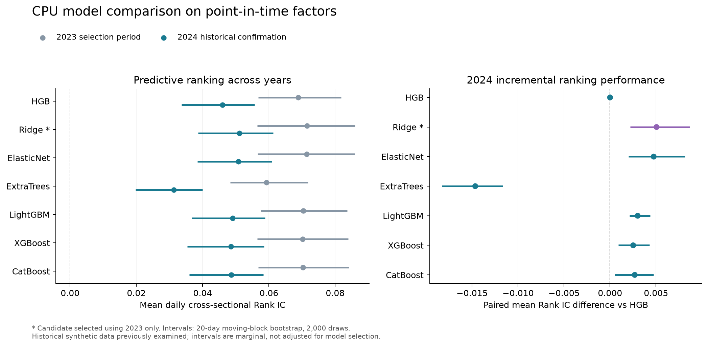

# 资产配置题目 CPU 模型比较报告

在已修正因子可用时点的同一份数据上，六种替代模型与 HGB 均已完成本地训练和跨年验证。**Ridge 在预先规定的 2023 年排序指标上入选，2024 年仍保留高于 HGB 的平均截面 RankIC；更复杂的提升树没有在该指标上超过 Ridge。** 但 Ridge 的尾部分组收益差低于 HGB，所有模型的 RMSE 均略高于训练均值基准，因此现有证据支持继续研究排序信号，不能仅据排序提升决定策略替换。

运行日期为 2026 年 10 月 11 日。研究范围为题目提供的匿名合成资产；未加入外部市场数据。运行完成状态及完整指标来自 `outputs/model_benchmark/`。

## 现有方法与本轮问题

原交接方法使用全部 20 个因子训练 `HistGradientBoostingRegressor`，从全期抽样后随机按行切分，并对包含训练样本的全期计算五日分组收益。前一阶段保持这些条件不变、仅修正因子时点后，随机验证 Pearson 从 0.336486 降到 0.092549；这是时点偏差影响的对照证据，尚未回答模型的时间外表现。

本轮研究回答两个问题：修正时点后哪些固定 CPU 模型能在后续年份维持截面排序能力；增加模型复杂度是否产生可观察的增量。Ridge 与 Elastic Net 是线性正则化参照，Extra Trees 是随机树平均参照，LightGBM、XGBoost 和 CatBoost 是其他提升树实现。方法、官方文档和许可来源见 [备选方法及来源](method_sources.md)。

## 实验设计

复用原有 PIT 面板，核对其 SHA256 与生成记录一致，保留同一组 20 因子和同一标签 `open(t+6)/open(t+1)-1`。每个阶段所有模型使用全部相同训练行，不随机抽样。所有模型先使用该阶段训练集的中位数补齐缺失；线性方法再用训练期均值与标准差缩放特征，Elastic Net 同时标准化训练收益并逆变换预测。评估集不参与这些步骤的拟合。

| 阶段 | 训练信号与成熟标签 | 评价信号 | 训练行数 | 评价行数与日期数 |
|---|---|---|---:|---:|
| 选择 | 2021–2022 信号，标签终点早于 2023-01-02 | 2023-01-02 至 2023-12-21，标签终点早于 2024-01-01 | 192,806 | 99,057 行，254 日 |
| 确认 | 2021–2023 信号，标签终点早于 2024-01-01 | 2024-01-01 至 2024-12-23 | 294,192 | 97,929 行，256 日 |

采用在评价首日前冻结的严格约定，训练边界分别清除 2,329 和 2,336 行；2023 评价期末另清除 2,336 行，避免用到 2024 年价格。每个年末对应 6 个信号日，而非对每只资产简单删掉 5 行。

参数在训练前写入 `protocol.json`，固定随机种子 1021，最多使用 4 个 CPU 线程。HGB 保留 55 轮、0.065 学习率、17 叶和 L2=0.2，并关闭随机内部验证早停；Ridge alpha=100；Elastic Net alpha=0.001、L1 比例 0.5；Extra Trees 64 棵、深度 8、叶节点至少 100 行；LightGBM 160 轮、17 叶；XGBoost 160 轮、深度 4；CatBoost 180 轮、深度 6。完整参数以协议为准。本轮没有参数搜索，没有向任何模型传入评价集进行早停，也没有按 2024 年结果重新选择模型。

以每天等权的截面 Spearman RankIC 作为唯一选模指标。2023 年完成后，先生成固定选择记录 `selection.json`，再重训并计算 2024 年。其他模型的 2024 年结果保留作描述性比较，预选确认候选仅为 Ridge。此前整份数据已被旧模型和全期因子研究使用，2024 年属于本轮流程的历史时间后段确认。

## 实际结果

| 模型 | 2023 平均 RankIC | 2024 平均 RankIC | 2024 五日毛分组差 | 2024 RMSE | 2024 拟合秒数 |
|---|---:|---:|---:|---:|---:|
| HGB | 0.068826 | 0.045993 | 0.6907% | 0.043460 | 0.85 |
| Ridge | 0.071504 | 0.051048 | 0.6390% | 0.043477 | 0.54 |
| ElasticNet | 0.071431 | 0.050735 | 0.6403% | 0.043474 | 0.62 |
| ExtraTrees | 0.059261 | 0.031329 | 0.4319% | 0.043478 | 3.22 |
| LightGBM | 0.070317 | 0.048994 | 0.6970% | 0.043480 | 1.19 |
| XGBoost | 0.070183 | 0.048506 | 0.7105% | 0.043482 | 1.01 |
| CatBoost | 0.070229 | 0.048681 | 0.7253% | 0.043481 | 1.84 |
| 训练均值基准 | 未定义 | 未定义 | 不分组 | 0.043404 | 0.48 |

Ridge 的 2024 年平均 RankIC 为 **0.051048**，20 日移动区块 bootstrap 的 95% 参考区间为 **[0.038633, 0.061255]**。对同一天的 HGB 做配对比较，平均增量为 **0.005055**，区间 **[0.002186, 0.008649]**。2023 年对应增量只有 0.002678，区间 [-0.000686, 0.004953]。这些是固定参数、特定历史区间上的结果，区间未作多模型比较校正。

需要区分排序和收益数值预测：2024 年 Ridge 的 RMSE 为 0.043477，训练均值基准为 0.043404；相对该基准的 R² 为 -0.003362。两年中七个模型的该 R² 均为负。观察到的截面排序信号还没有转化成更准确的收益幅度预测。

尾部表现也没有随 RankIC 一起提高。Ridge 的 2024 年五日毛分组差为 0.6390%，低于 HGB 的 0.6907%；CatBoost 为 0.7253%。这里未因观察到 CatBoost 的尾部结果而改选候选。每侧十分位具有截面样本数的 10% 总权重，临界分数并列时等比例分配，常数预测不产生分组差。这是未来五日分组诊断，尚未应用仓位资金、成交、换手和成本。

## 稳定性与计算成本



Ridge 在 2024 年四个季度的平均 RankIC 分别为 0.050233、0.060041、0.035024、0.059817，均高于同季度 HGB，但第三季度明显偏弱。将信号按合成工作日分成五个起点、每隔五日取一次，Ridge 的平均 RankIC 范围为 0.047874–0.057492，五种起点均高于 HGB。不同起点的尾部分组差没有一致超过 HGB，进一步说明排序和尾部选股表现并非同一个结论。

所有模型在每一阶段均有完整且相同的 254 或 256 个有效 RankIC 日期；训练均值基准的相关性保持未定义。区块重采样使用连续 20 个合成工作日、2,000 次抽样，并对相同日期的模型差值联合重采样；没有把重叠五日标签当成独立日收益计算年化夏普。

本机两个阶段的核心运行分别约 9.93 秒和 13.44 秒，包含数据读取、训练、评价与结果输出，不含依赖下载、安装和作图。Ridge 两次拟合分别约 0.34 秒和 0.54 秒；实际耗时随机器而变。环境为 Python 3.12.13、NumPy 2.5.4、pandas 2.3.3、scikit-learn 1.9.1、LightGBM 4.7.0、XGBoost 3.4.1、CatBoost 1.2.10，全部使用 CPU。

## 研究判断和下一步

保留 Ridge 作为简单、可解释、计算便宜的排序基线。现有结果没有支持仅为提高平均 RankIC 而换用复杂提升树；同样不能据 Ridge 的排序领先就推断其组合收益更高。下一项有价值的验证是把预选 Ridge 与 HGB 的时间外预测接入同一持仓账本，使用相同资金、约束、换手和成本口径比较，并检查信号的行业与风格来源。

本轮证据有三项实质边界。第一，原始样本为已被研究过的合成数据，不是从未查看的新样本。第二，复用面板只保留未来标签端点可观察的成员资产，退市后缺价格的记录已退出评价，结果不能代表完整实时可投资股票池。第三，模型使用不同的固定复杂度，比较未覆盖各算法调优后的能力上限。当前选择适合用作下一轮研究起点。

## 复现与证据

在工作区根目录执行。已安装的专用环境为 `asset_allocation/.venv_models/`；新的 Python 3.12 环境可按 `asset_allocation/requirements-models.txt` 安装依赖。macOS 还需要 OpenMP，见 [官方安装说明](https://github.com/lightgbm-org/LightGBM/blob/main/python-package/README.rst)。本机通过 Homebrew 安装 libomp 23.1.0，首次缺依赖的日志与修复后成功检查均保留。

```bash
# 新环境初始化，仅在尚无专用环境时执行
python3.12 -m venv asset_allocation/.venv_models
asset_allocation/.venv_models/bin/python -m pip install -r asset_allocation/requirements-models.txt
# macOS 如尚无 OpenMP：brew install libomp

# 验证本轮契约
asset_allocation/.venv_models/bin/python -B -m unittest discover -s asset_allocation -p 'test_compare_models.py' -v

# 使用新的输出目录，保留本次已完成证据
OMP_NUM_THREADS=4 OPENBLAS_NUM_THREADS=1 MKL_NUM_THREADS=1 asset_allocation/.venv_models/bin/python -B asset_allocation/compare_models.py --stage validation --out asset_allocation/outputs/model_benchmark_reproduction
OMP_NUM_THREADS=4 OPENBLAS_NUM_THREADS=1 MKL_NUM_THREADS=1 asset_allocation/.venv_models/bin/python -B asset_allocation/compare_models.py --stage confirmation --out asset_allocation/outputs/model_benchmark_reproduction
asset_allocation/.venv_models/bin/python -B asset_allocation/plot_model_comparison.py --out asset_allocation/outputs/model_benchmark_reproduction
```

脚本拒绝覆盖已经存在的阶段目录；更改代码、参数或环境后必须使用新输出目录。确认阶段会核验冻结协议、选择记录和验证期产物哈希。上述两次正式核心命令已在独立进程实际执行，本轮 10 项测试全部通过。

| 证据 | 位置 |
|---|---|
| 运行前参数、输入与代码哈希 | `outputs/model_benchmark/protocol.json` |
| 仅按 2023 年生成的选择记录 | `outputs/model_benchmark/selection.json` |
| 两阶段样本边界与有序键哈希 | 各阶段 `split_manifest.json` |
| 每模型完整预测与预处理统计 | 各阶段 `*_predictions.csv.gz`、`*_fit_metadata.json` |
| 主要表、季度、五起点和耗时 | 各阶段 `summary.csv`、`quarterly.csv`、`phases.csv`、`timing.csv` |
| 逐日指标与完成记录 | 各阶段 `daily_metrics.csv`、`run_manifest.json` |
| 独立重算与完整性核验 | `outputs/model_benchmark/verification.json` |
| 比较图及输入输出校验 | `outputs/model_benchmark/model_comparison.png`、`.pdf`、`plot_manifest.json` |
| 下载包、许可、安装与检查日志 | `vendor/wheels/`、`outputs/model_environment/` |

原始数据包、原交接代码和前阶段结果保留原样。下载的第三方实现为官方 Python 发行包；来源与许可集中列于方法说明，未复制外部策略，也未新增金融数据。
