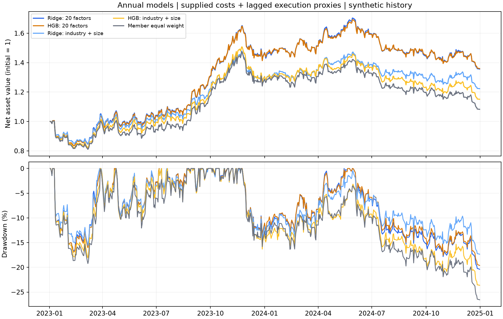
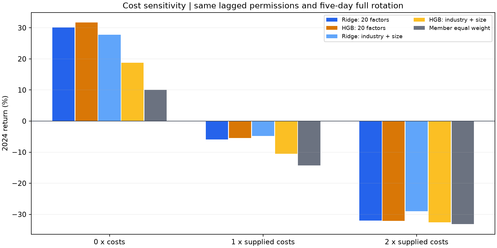

# 年度预测模型的统一组合回测

研究日期：2026 年 10 月 11 日。数据版本：Alpha Forensics Candidate v1，匿名合成资产。8 次固定参数年度模型拟合、15 个资金回测情景均已完成，账本及配对统计已独立核验。

阶段说明：本文件保留五日完整换仓的原始对照。后续净额执行及固定调仓方法的结果见[调仓研究报告](rebalance_study_report.md)，本文件的历史数值和执行规则保持原样。

## 研究判断

在五日完整轮换、题包成本及前日交易许可代理下，全 20 因子 Ridge、HGB 的 2023—2024 年累计收益分别为 **35.63% 和 35.98%**，但 2024 年分别为 **−5.94% 和 −5.44%**。两年正收益依赖 2023 年的上涨，尚未显示逐年稳定的绝对盈利。

两模型在 2024 年都优于采用相同轮换规则的成员等权基准，但全因子 Ridge 当年未超过行业市值 Ridge 基准。两种全因子模型相对各自行业市值基准的日收益差值参考区间均跨零，尚未获得稳定净增量的证据。此前 Ridge 的 RankIC 领先也没有转化为明确的组合优势。

成本敏感性是下一步最直接的研究问题。保持其他规则不变，两倍成本时五个组合在全期及 2024 年均亏损。当前可保留全因子模型及简单基准继续比较，优先研究减少重复买卖后的表现。独立新样本验证仍列为取得额外数据后的未来研究。

## 1. 比较对象与信号覆盖

保留已确定的全 20 因子 Ridge、HGB，以及只用行业和对数市值的同类基准；再加入当期成员等权。每个年度沿用此前模型比较的训练记录、预处理和固定参数，训练标签必须在该年度首个信号日前成熟。2023 年训练 192,806 行，2024 年训练 294,192 行；不根据本次资金回测重新选模型或调参。

原年度研究只保存了有标签评价记录的预测，因此本次按原规则重训并生成完整成员预测。每个模型覆盖 2023 年 101,397 行和 2024 年 100,265 行，共 **201,662 行、522 个日期**，其中 **2,340 行没有完整未来五日收益**，仍保留用于交易决策。在原归档评价键上的预测最大差异约 1.01×10⁻¹⁶。因子取值仍按发布时间对齐；行业、市值沿用信号日盘后已知的假设。

2023 年已经参与前期选模，列为开发期描述；2024 年为本轮主要比较期，但也属于已被查看过的历史样本。资金账户从 2023 年连续运行至 2024 年，2024 年收益以 2023 年末净值为起点，并承接已有持仓。该年度账本与此前季度 HGB 扩展不同，结果应在本报告内部比较。

## 2. 固定资金与交易规则

- 初始本金为 1，分为五份初始等额资金，每天轮到一份。盘后按完整当期成员池选预测值不低于 90% 分位数的资产，组内等权；所有边界并列均保留。全因子及 Ridge 基准通常选 38—39 个资产，HGB 行业市值基准为 38—46 个。成员等权基准使用所有当期成员。
- t 日盘后固定名单和含费预算，t+1 开盘买入，正常在 t+6 开盘卖出。资金份分别再投资，不融资，允许分数股，现金无息。买入受阻的预算保留为现金，不补选或重分配；卖出受阻则保留仓位、逐日重试。
- 各资金份按到期全额卖出再买入，**同一日、同一资产的卖出和买入也不抵消**。等权和行业市值基准执行相同规则，因此这里比较的是同频完整轮换组合。
- 可买卖标记使用前一个合成交易日的值；当日最终标记只用于核查假设成交。每笔实际买卖的费用为前日单边手续费＋半价差＋冲击代理。零、一、二倍成本情景仅改变三项费率，持仓规则和前日权限保持一致。
- 首次缺失报价时按零回收核销，单列这一估值假设的损失。最后入场信号固定为 2024-12-23，账户终点为 2024-12-31；仍无法卖出的仓位按终日收盘价估值。

每日以现金及收盘持仓价值计算净值。Sharpe、波动率按日净值收益和 252 个合成交易日计算，无风险利率为零；年度回撤包含上一年末净值作为期初峰值。五日预测标签仅用于训练和诊断，不作为日净值收益累加。

## 3. 题包成本下的结果

| 组合 | 2023 收益 | 2024 收益 | 两年累计收益 | 2024 日净值 Sharpe | 2024 最大回撤幅度 | 2024 日均双边换手 |
|---|---:|---:|---:|---:|---:|---:|
| Ridge 全 20 因子 | 44.20% | -5.94% | 35.63% | -0.26 | 20.38% | 38.83% |
| HGB 全 20 因子 | 43.80% | -5.44% | 35.98% | -0.23 | 19.61% | 38.92% |
| Ridge 行业市值基准 | 28.42% | -4.76% | 22.30% | -0.20 | 16.94% | 38.94% |
| HGB 行业市值基准 | 28.65% | -10.53% | 15.10% | -0.52 | 21.13% | 39.05% |
| 成员等权基准 | 26.27% | -14.26% | 8.26% | -0.74 | 23.88% | 39.04% |

Ridge、HGB 全因子在 2024 年相对成员等权的相对财富增幅分别为 **9.70% 和 10.29%**，计算方式为两组合年度财富增长倍数之比减一。Ridge 相对同类行业市值基准为 **−1.24%**，HGB 为 **+5.69%**；这些点估计需结合下方差值区间判断。



## 4. 成本与差值不确定性

下表为 2024 年组合收益，所有情景均使用相同的前日交易许可代理：

| 组合 | 零成本 | 题包成本 | 两倍成本 |
|---|---:|---:|---:|
| Ridge 全 20 因子 | 30.11% | -5.94% | -31.96% |
| HGB 全 20 因子 | 31.69% | -5.44% | -32.06% |
| Ridge 行业市值基准 | 27.79% | -4.76% | -28.99% |
| HGB 行业市值基准 | 18.79% | -10.53% | -32.57% |
| 成员等权基准 | 10.00% | -14.26% | -33.15% |

当前五日完整轮换产生约 39% 的日均双边换手。零成本下的正收益在题包成本下转负；两倍成本下，2024 年亏损约 29%—33%，两年累计收益也全部为负。费用对比来自重新运行完整资金账户，包含资金再投资的变化，不能将累计收益之差直接当作累计现金扣费额。



按相同日期配对，对连续 20 个交易日做 2,000 次移动区块重采样；下表为题包成本下的 2024 年日算术收益差。另保存日对数相对增长率结果，其区间结论一致。这些参考区间未作多项比较校正。

| 同日组合收益差 | 平均差值（基点/日） | 95% 参考区间（基点/日） |
|---|---:|---:|
| Ridge 全 20 因子 − HGB 全 20 因子 | -0.20 | [-0.99, +1.29] |
| Ridge 全 20 因子 − Ridge 行业市值基准 | -0.44 | [-4.21, +3.59] |
| HGB 全 20 因子 − HGB 行业市值基准 | +2.08 | [-1.86, +5.49] |
| Ridge 全 20 因子 − 成员等权基准 | +3.49 | [+1.19, +6.16] |
| HGB 全 20 因子 − 成员等权基准 | +3.69 | [+1.14, +5.79] |

两种全因子模型均取得相对同频等权的正差值区间，但相对同类行业市值基准的区间均包含零，Ridge 与 HGB 之间也未显示明确净收益差异。保留简单基准有必要，当前结果不足以支持仅凭预测排序指标决定组合替换。

## 5. 执行与估值边界

全因子 Ridge 和 HGB 在题包成本下分别有 **283/39,533 笔、279/39,668 笔**假设成交与当日最终方向标记冲突，约为 0.72% 和 0.70%。前日许可不能证明次日开盘一定能成交；这些记录保存在订单中，未用日终状态倒改名单。冲击费用也是标准订单费率，尚不能据此推断资金容量。

Ridge 与 HGB 的缺报价核销损失分别约为初始本金的 **4.70% 和 4.07%**；题包没有退出结算价，零回收属于本次估值约定，需要后续检验其敏感性。

完整换仓还包含大量可抵消的重复买卖。按同日、同资金份、同资产买卖名义额的较小值计算，双边重合额占总成交额：Ridge 全因子 **34.41%**、HGB 全因子 **34.83%**、Ridge 行业市值基准 **93.11%**、HGB 行业市值基准 **73.74%**、成员等权 **96.57%**。这些是事后成交重合诊断，未模拟净额调仓后的现金、权限和再投资，不能直接扣掉费用重算收益。它们说明同频等权及简单基准承受了大量重复交易，当前相对优势不能推广为对低换手基准的优势。

## 6. 团队下一步

首先预先固定净额调仓规则，对同一资产保留可续持的仓位、仅交易目标与现有持仓之差，再与当前完整轮换账本和同口径简单基准比较。重点检查换手下降后，全因子模型是否仍提供增量，避免只优化全因子组合而保留高换手基准。

随后核验成交状态与退出结算假设，并报告成本压力下的相对表现。独立新样本验证需题方提供同口径新增数据或隐藏测试集；取得数据前固定训练更新、组合规则及评价标准。该阶段未实施净额调仓；后续固定调仓比较已另行开展，见[调仓研究报告](rebalance_study_report.md)。独立新样本尚未取得。

## 7. 复现与证据

本轮新增 6 项覆盖完整信号、归档预测复现和年度计量的测试，加上复用账本的 11 项测试，合计 **17 项通过**。独立审计从订单重建各资金份现金、库存和净值，核对完整买入名单、开盘价、前日费用和权限、核销及年度指标；15 个情景全部通过，最大净值误差约 **5.64×10⁻¹³**。另独立复算 **126 行**配对统计，最大误差约 **1.03×10⁻¹⁶**。原题包 21 个校验文件保持不变。

沿用 `asset_allocation/.venv_models/` 和已有依赖。在工作区根目录运行，复现时使用新的输出目录：

```bash
PYTHONPATH=asset_allocation OMP_NUM_THREADS=4 OPENBLAS_NUM_THREADS=1 MKL_NUM_THREADS=1 MPLCONFIGDIR=/private/tmp/asset-allocation-mpl asset_allocation/.venv_models/bin/python -B -m unittest test_portfolio_model_comparison test_portfolio_ledger -v
OMP_NUM_THREADS=4 OPENBLAS_NUM_THREADS=1 MKL_NUM_THREADS=1 MPLCONFIGDIR=/private/tmp/asset-allocation-mpl asset_allocation/.venv_models/bin/python -B asset_allocation/portfolio_model_comparison.py --out asset_allocation/outputs/portfolio_model_comparison_replay
OMP_NUM_THREADS=4 OPENBLAS_NUM_THREADS=1 MKL_NUM_THREADS=1 asset_allocation/.venv_models/bin/python -B asset_allocation/audit_portfolio_model_comparison.py --out asset_allocation/outputs/portfolio_model_comparison_replay
```

| 证据 | `outputs/portfolio_model_comparison/` 内的位置 |
|---|---|
| 运行前规则、输入与源码校验 | `protocol.json` |
| 年度拟合及旧预测复现 | `fits.csv`、`models/` |
| 完整预测与选股范围 | `predictions/`、`signal_coverage.csv`、`selection_diagnostics.csv` |
| 全期、年度及成本对照 | `summary.csv`、`period_metrics.csv` |
| 日收益及对数相对增长率差值 | `paired_comparisons.csv` |
| 每日净值、委托及逐日持仓 | `runs/各方案/` |
| 独立账本与统计核验 | `verification.json`、`statistical_verification.json` |
| 环境、命令及产物校验 | `run_manifest.json` |

原数据、既有模型比较、因子筛选、行业市值检验及季度 HGB 回测均保留。本轮结果纳入[正式研究报告](research_report.md)，不替代独立新样本验证。
