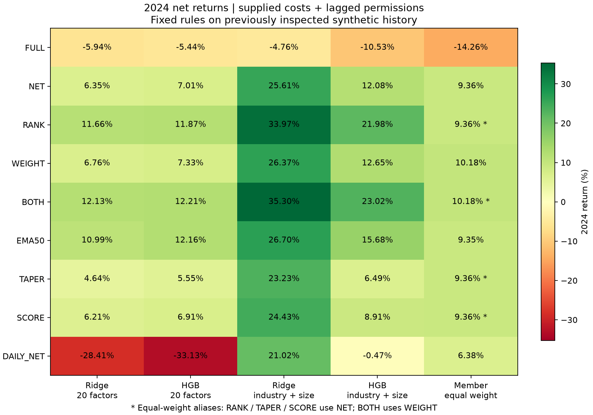
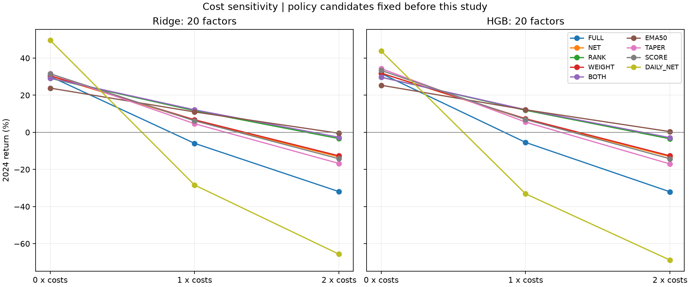

# 固定调仓方法的分层比较

研究日期：2026 年 10 月 11 日。数据为 Alpha Forensics Candidate v1 匿名合成资产。

已完成 108 个新账户、15 个历史 FULL 参照及明确标识的等权别名比较。33 项相关测试、108 个账户的独立资金执行审计、152 行配对统计和 405 行引用核验均通过。

## 1. 研究问题与固定设计

上一轮采用五份资金交错持有五日、到期完整卖出再买入的规则，包含同日同资产的重复交易。本轮先比较净额调仓，再分别改变排名保留、权重调整、目标平滑和分配方式，最后单独比较全账户逐日调整。预测模型、因子和完整成员预测均保持不变，不新增模型训练、不搜索规则参数。

沿用年度全 20 因子 Ridge、HGB、各自仅使用行业与市值的基准，并设置成员等权参照。每个模型均有 201,662 条完整成员预测，其中 2,340 条没有完整未来五日标签，交易名单不按标签是否缺失筛选。2023 年为开发期描述；2024 年为主要比较期，但已被研究过，所有新增结果均为追加历史研究。

行业和市值沿用前阶段“信号日盘后可知”的研究假设，题包没有单独的发布时间记录。

各方法只固定一个版本，在读取本轮账户结果前保存协议、输入与源码哈希。新运行 108 个实际账户：四个预测器各八种方法、三档成本，另加等权的四种有效方法、三档成本。上一轮 15 个 FULL 账户直接引用并核对哈希。没有排名或分数的等权基准不运行 RANK、TAPER、SCORE，而引用 NET；BOTH 等权引用 WEIGHT。这些别名不计为独立实验。

## 2. 方法与参数

| 方法 | 固定规则 | 主要改变 |
|---|---|---|
| FULL | 上一轮五份资金到期全卖再买，边界并列全保留 | 历史执行对照 |
| NET | 原前 10% 名单和组内等权；仅交易目标与实际股数之差 | 避免同一资金份内重复买卖 |
| RANK | 前 10% 入场、前 20% 续持；先保留实际持仓，再按分数组补足约 10% 的席位，临界同分整组保留；旧保留仓超过席位数时不补新仓 | 排名缓冲、持有时间 |
| WEIGHT | 目标权重的上下 10% 相对缓冲；信号收盘时在区间内保持股数，越界调至最近边界，新仓按目标配置，退出优先 | 减少小幅权重调整 |
| BOTH | 同时采用 RANK 和 WEIGHT，相同参数 | 两种缓冲的组合 |
| EMA50 | 每个资金份轮到时，将新 NET 目标与该份上次平滑目标各取一半；从现金开始，不重新归一；资格失效目标归零 | 反应速度、现金与持有时间 |
| TAPER | 保留 NET 入选范围，按名单内平均排名线性递减分配，同分同权，合计目标权重为 1 | 集中度及排名到权重的映射 |
| SCORE | 保留 NET 入选范围，分数减全成员均值后取正值，按比例分配；单资产上限为 2/M，M 为入选数；剩余额度在正分资产间分配，容量不足留现金，全同分空仓 | 分数到权重的探索性映射 |
| DAILY_NET | 一份完整资金每天按 NET 目标调整 | 更新频率及初始资金部署 |

排名缓冲依据已经成交后的真实持仓，不使用上期目标冒充持仓。目标席位数为 `ceil(0.1×当期成员数)`，同分保留及已有保留仓可能使实际数量超过该值；报告实际数量。同分不按资产编号分出优劣。

方法思想参考个人既有多因子项目的 `RebalancePolicy`、`smooth_target_weights`、`generate_tapered_targets` 与 `generate_score_weighted_targets`。本题重新实现为日频、做多现金账户，未复用原永续合约账本，也不将该项目历史绩效当成本题的证据。

## 3. 共同资金与执行规则

NET 至 SCORE 沿用五份初始各 0.2 的资金，每日轮到一份、每份每五个交易日重新评估；连续入选可以续持。DAILY_NET 则使用一份初始为 1 的账户每日重新评估，因此其差异同时包含频率和资金部署的变化。

信号日收盘冻结名单、目标权重和该资金份收盘净值预算。次日开盘先处理缺报价持仓的零回收核销，再按“收盘预算与实际开盘净值的较小值”确定执行预算，结合开盘价格换算目标股数。权重缓冲内的股数保持收盘时确定的值。

新计划先替代旧的未完成卖出目标，再执行卖出差额；受阻减仓保留股数目标，逐日重试。买入仅在新计划的执行日发生，全部原始买单按含费需求统一缩放至可用现金；被禁买或缺开盘报价的预算槽也计入分母，避免将其额度转给其他名字。未成交买单当日失效，不借款、不跨资金份划转或抵消。

费用和可买卖许可均来自前一个交易日；当日最终方向标记仅用于审计。零、题包、两倍成本三个账户分别按自身持仓与现金决策，不能共享另一成本账户的订单。各资产缺报价的持仓按零回收核销，期末受阻仓位按实际收盘价计值。前日许可不能证明次日开盘实际可成交，零回收核销也是估值假设；相关订单、冲突和核销金额保留在输出中。

新入场信号截止 2024-12-23。五份资金随后各自在下一次正常轮换日生成零目标；DAILY_NET 截止后暂停普通调整，在 2024-12-30 收盘生成零目标、于终日开盘尝试退出。终末零目标绕过 EMA 与缓冲，卖不出仍按许可重试。

## 4. 实际结果

### 4.1 2024 年、题包成本下的净收益

| 方法 | Ridge 全因子 | HGB 全因子 | Ridge 行业市值 | HGB 行业市值 | 成员等权 |
|---|---:|---:|---:|---:|---:|
| 完整换仓 FULL | -5.94% | -5.44% | -4.76% | -10.53% | -14.26% |
| 净额 NET | 6.35% | 7.01% | 25.61% | 12.08% | 9.36% |
| 排名缓冲 RANK | 11.66% | 11.87% | 33.97% | 21.98% | 9.36% * |
| 仓位缓冲 WEIGHT | 6.76% | 7.33% | 26.37% | 12.65% | 10.18% |
| 双缓冲 BOTH | 12.13% | 12.21% | 35.30% | 23.02% | 10.18% * |
| 目标平滑 EMA50 | 10.99% | 12.16% | 26.70% | 15.68% | 9.35% |
| 梯形 TAPER | 4.64% | 5.55% | 23.23% | 6.49% | 9.36% * |
| 分数权重 SCORE | 6.21% | 6.91% | 24.43% | 8.91% | 9.36% * |
| 全账户逐日 DAILY_NET | -28.41% | -33.13% | 21.02% | -0.47% | 6.38% |

星号为等权引用：RANK、TAPER、SCORE 使用 NET 等权，BOTH 使用 WEIGHT 等权；这些单元格没有另外运行账户。所有收益均从各自 2023 年末净值计算，包含延续的现金和持仓。



### 4.2 成本压力

下表为两种全因子模型的 2024 年收益。所有成本情景使用相同的前日权限规则。

| 方法 | Ridge 零成本 | Ridge 两倍成本 | HGB 零成本 | HGB 两倍成本 |
|---|---:|---:|---:|---:|
| 完整换仓 FULL | 30.11% | -31.96% | 31.69% | -32.06% |
| 净额 NET | 30.39% | -13.22% | 31.85% | -13.13% |
| 排名缓冲 RANK | 29.09% | -3.38% | 29.73% | -3.50% |
| 仓位缓冲 WEIGHT | 30.55% | -12.67% | 31.91% | -12.63% |
| 双缓冲 BOTH | 29.22% | -2.67% | 29.65% | -2.85% |
| 目标平滑 EMA50 | 23.82% | -0.50% | 25.36% | 0.37% |
| 梯形 TAPER | 31.62% | -16.78% | 34.35% | -17.04% |
| 分数权重 SCORE | 31.57% | -14.24% | 33.35% | -14.25% |
| 全账户逐日 DAILY_NET | 49.58% | -65.67% | 43.79% | -68.85% |

NET 的全因子组合在两倍成本下仍亏损约 13%；RANK、BOTH 将亏损收窄至约 3%，EMA50 接近盈亏平衡。同期 NET 行业市值 Ridge、HGB 基准分别为 **23.26%、5.85%**，NET 等权为 **8.69%**；BOTH 的行业市值基准分别为 **34.58%、20.37%**，适用的 WEIGHT 等权为 **9.82%**。因此，降换手缓解了成本敏感性，但全因子组合相对简单基准的弱势仍需解释。



### 4.3 换手、现金与组合结构

以下为 Ridge 全因子组合的 2024 年、题包成本诊断；HGB 及全部基准的同口径字段见 `period_metrics.csv`。

| 方法 | 日均双边换手 | 平均现金占比 | 平均持仓资产数 | 平均 HHI | 最大回撤幅度 |
|---|---:|---:|---:|---:|---:|
| 完整换仓 FULL | 38.83% | 2.90% | — | — | 20.38% |
| 净额 NET | 25.97% | 2.46% | 92.1 | 0.0143 | 14.82% |
| 排名缓冲 RANK | 18.26% | 2.20% | 84.9 | 0.0156 | 12.48% |
| 仓位缓冲 WEIGHT | 25.68% | 2.46% | 92.1 | 0.0144 | 14.63% |
| 双缓冲 BOTH | 17.89% | 2.23% | 84.9 | 0.0157 | 12.22% |
| 目标平滑 EMA50 | 13.90% | 1.82% | 376.8 | 0.0099 | 12.32% |
| 梯形 TAPER | 27.85% | 2.89% | 92.1 | 0.0195 | 15.51% |
| 分数权重 SCORE | 26.60% | 2.70% | 92.1 | 0.0161 | 14.80% |
| 全账户逐日 DAILY_NET | 95.12% | 1.21% | 38.4 | 0.0254 | 33.57% |

FULL 引用未补算持仓数量和 HHI，缺失值不作零处理。HGB 全因子的日均双边换手由 NET 的 **26.00%**降至 RANK 的 **17.87%**、BOTH 的 **17.48%**和 EMA50 的 **13.80%**；DAILY_NET 则上升到 **98.14%**。

EMA50 的平均正持仓数量含大量逐渐衰减的小仓位，不能将约 375—377 只理解为等权配置同等数量资产。2024 年 EMA50 全因子现金比例约为 **1.7%—1.8%**，低于 NET 的约 **2.1%—2.5%**，本期改善没有依靠大幅增加现金，但其持仓分布和信号响应速度已经改变。RANK/BOTH 的跨资金份合并持仓更集中，也不属于风险结构完全不变的交易成本对照。

### 4.4 开发期和全期描述

| 方法 | Ridge 2023收益 | HGB 2023收益 | Ridge两年累计 | HGB两年累计 |
|---|---:|---:|---:|---:|
| 完整换仓 FULL | 44.20% | 43.80% | 35.63% | 35.98% |
| 净额 NET | 63.76% | 64.55% | 74.17% | 76.08% |
| 排名缓冲 RANK | 68.98% | 69.29% | 88.68% | 89.37% |
| 仓位缓冲 WEIGHT | 64.48% | 65.26% | 75.60% | 77.38% |
| 双缓冲 BOTH | 70.06% | 70.30% | 90.69% | 91.09% |
| 目标平滑 EMA50 | 73.99% | 73.99% | 93.10% | 95.16% |
| 梯形 TAPER | 59.96% | 58.73% | 67.38% | 67.54% |
| 分数权重 SCORE | 62.82% | 62.98% | 72.92% | 74.24% |
| 全账户逐日 DAILY_NET | 19.29% | 17.50% | -14.60% | -21.43% |

2023 年 RANK、BOTH、EMA50 相对 NET 的改善方向与 2024 年一致，TAPER、SCORE 和 DAILY_NET 相对 NET 较弱。该方向复现仍来自已经查看过的同一合成样本，不增加独立新样本证据。


## 5. 差值区间与判断

主要不确定性比较限定在 2024 年、题包成本：NET 对 FULL，其余每种方法对同预测器 NET；另比较相同方法下的 Ridge/HGB、全因子与同类行业市值基准、全因子与适用的等权基准。对同日算术收益差和日对数相对增长率差，使用连续 20 个交易日移动区块、2,000 次重采样、随机种子 1021。

区间是预先固定对照的参考区间，未作多项比较校正；结果不用于宣布已经通过独立验证的最优方案。净收益、回撤、成本和换手须与现金比例、持仓数量、集中度一起理解。集中度 HHI 定义为资产占账户净值权重的平方和，先合并同一资产在不同资金份的仓位，现金增加也会降低该指标。

下表为全因子模型的日算术收益差，单位均为**基点/日**；括号内为 95% 参考区间。

| 调仓方法增量 | Ridge 均值及95%区间 | HGB 均值及95%区间 |
|---|---:|---:|
| 净额 NET − FULL | +4.69 [+4.30, +5.16] | +4.72 [+4.36, +5.19] |
| 排名缓冲 RANK − NET | +1.85 [+0.88, +2.78] | +1.68 [+0.84, +3.02] |
| 仓位缓冲 WEIGHT − NET | +0.15 [+0.03, +0.21] | +0.12 [+0.01, +0.20] |
| 双缓冲 BOTH − NET | +2.01 [+1.07, +2.89] | +1.80 [+0.99, +3.09] |
| 目标平滑 EMA50 − NET | +1.62 [+0.67, +2.84] | +1.79 [+0.89, +3.30] |
| 梯形 TAPER − NET | -0.64 [-1.89, +0.32] | -0.53 [-1.54, +0.23] |
| 分数权重 SCORE − NET | -0.06 [-0.62, +0.37] | -0.04 [-0.50, +0.26] |
| 全账户逐日 DAILY_NET − NET | -15.08 [-17.08, -13.20] | -17.90 [-19.94, -15.82] |

由此保留以下研究判断：

1. **净额执行应成为后续比较的基线。** 五个预测器及基准从 FULL 改为 NET 的主期日收益增量区间均高于零。Ridge、HGB 全因子从 −5.94%、−5.44% 转为 6.35%、7.01%，日均双边换手约从 39% 降到 26%。零成本下两者收益仅增加约 0.28、0.17 个百分点，而题包成本下增加约 12 个百分点，说明本次收益提升主要与交易摩擦减少相关。受阻成交和节约成本后再投资也会改变持仓路径，不能把全部净值差直接视为现金费用节约。
2. **RANK、BOTH、EMA50 值得保留为后续固定候选。** 三者对两种全因子模型的主期增量参考区间均为正；WEIGHT 单独的提升较小。BOTH 和 EMA50 的收益接近，不能按这次点估计差异宣布最优规则。排名和权重缓冲影响持仓路径，EMA 还改变历史目标的保留和权重分布。
3. **本轮没有支持增加梯形或分数比例配置复杂度的证据。** 两种全因子模型的 TAPER、SCORE 均未超过 NET，差值区间跨零，且集中度更高。DAILY_NET 则因接近 100% 的日均双边换手遭受较大成本侵蚀；即使零成本收益较高，题包成本下仍亏损 28%—33%。这一方案同时改变频率和资金组织，不将差异全部归因于单一调仓频率。
4. **更合理的执行并未证明匿名因子的组合增量。** NET 下，行业市值 Ridge、HGB 基准为 25.61%、12.08%，均高于对应全因子的 6.35%、7.01%；等权为 9.36%。BOTH 下全因子约 12%，行业市值基准却为 35.30%、23.02%。全部八种新规则下，Ridge 全因子相对同规则行业市值基准的日收益差值区间均低于零；HGB 也均为负的点估计，其中多数区间跨零。跨方法结果相关，不能当作八份独立证据。

几个主要规则的基准差值如下，同样以基点/日表示：

| 同规则全因子−行业市值基准 | Ridge 均值及95%区间 | HGB 均值及95%区间 |
|---|---:|---:|
| NET | -6.34 [-10.23, -2.55] | -1.81 [-5.84, +1.43] |
| BOTH | -7.14 [-10.31, -3.90] | -3.55 [-7.12, -0.06] |
| EMA50 | -5.05 [-8.34, -1.64] | -1.23 [-4.28, +1.81] |

RANK、BOTH、EMA50 全因子组合对适用等权的主期日收益增量区间均跨零。当前支持“执行方式可改进、部分降换手规则值得保留”，尚不支持“全 20 因子已产生稳定可实现的独立收益”。下一步将净额执行和低换手简单基准保留为共同起点，优先解释全因子信号的换手来源及相同风险、换手预算下的增量；新样本到位后再验证少数预先固定方案。本轮未据结果追加参数、选出独立验证冠军或继续训练模型。


## 6. 核验与复现

16 项新增调仓契约测试、11 项复用账本测试和 6 项预测覆盖及年度计量测试，合计 **33 项通过**。其中零费用、无交易阻塞的小样例核对了隔夜上涨和下跌时净额账本与原完整换仓的逐日持仓、净值一致性。

独立审计未调用交易引擎或其权重函数，从原始行情、权限、预测与保存委托重建全部 **108 个账户**，共检查 **5,270,930 次订单尝试、5,234,663 笔成交**。逐项核对现金、库存、净值、原始开盘价、前日费用和权限、排名与权重规则、开盘目标、统一买入缩放、受阻预算不重分配、新计划覆盖旧卖出意图、终末清退及年度指标。最大现金误差约 **1.48×10⁻¹²**，最大净值误差约 **1.72×10⁻¹²**。

另外独立重算 **152 行**主要配对统计，均值与区间最大误差约 **9.95×10⁻¹⁷**；核对 **405 行**比较表，包含 324 行新账户分期结果、45 行旧 FULL 引用和 36 行别名，引用误差为零。输入、源码和产物校验通过，未将别名计作独立账户。以上核验确认实现和统计可复核，不替代独立新样本及真实开盘成交状态的验证。

本次主计算约 4 分 03 秒，独立资金执行审计约 13 分 42 秒。测试及运行日志分别为 `outputs/rebalance_study_tests.log`、`outputs/rebalance_study_run.log` 和 `outputs/rebalance_study_audit.log`。


复用原模型比较环境和依赖，无需下载新库。在工作区根目录运行，输出目录必须尚不存在：

```bash
PYTHONPATH=asset_allocation OMP_NUM_THREADS=1 OPENBLAS_NUM_THREADS=1 MKL_NUM_THREADS=1 MPLCONFIGDIR=/private/tmp/asset-allocation-mpl asset_allocation/.venv_models/bin/python -B -m unittest test_rebalance_ledger test_portfolio_ledger test_portfolio_model_comparison -v
OMP_NUM_THREADS=1 OPENBLAS_NUM_THREADS=1 MKL_NUM_THREADS=1 MPLCONFIGDIR=/private/tmp/asset-allocation-mpl asset_allocation/.venv_models/bin/python -B asset_allocation/rebalance_study.py --out asset_allocation/outputs/rebalance_study_replay --workers 2
OMP_NUM_THREADS=1 OPENBLAS_NUM_THREADS=1 MKL_NUM_THREADS=1 asset_allocation/.venv_models/bin/python -B asset_allocation/audit_rebalance_study.py --out asset_allocation/outputs/rebalance_study_replay
```

| 证据 | `outputs/rebalance_study/` 内的位置 |
|---|---|
| 固定方法、参数、时点、来源校验 | `protocol.json` |
| 108 个实际新账户的全期指标 | `summary.csv` |
| 新账户全期及年度指标 | `period_metrics.csv` |
| 包含旧 FULL 及明确标注别名的对照表 | `comparison.csv` |
| 152 行主要配对统计 | `paired_comparisons.csv` |
| 目标计划、预算、委托、每日持仓与净值 | `runs/各方案/` |
| 独立资金执行核验及统计核验 | `verification.json`、`statistical_verification.json` |
| 环境、命令、完成状态和产物校验 | `run_manifest.json` |

原始题包、此前预测和组合结果均保留。独立新样本验证仍需额外数据，继续列为未来研究。
