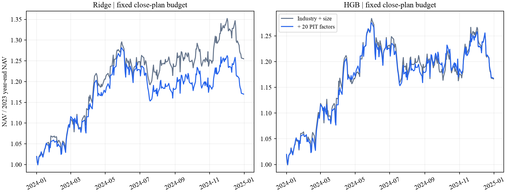

# Alpha Forensics：从预测审计到组合增量检验

资产配置策略方向研究报告 · 陈星宇 · 2026-10-11

数据：Alpha_Forensics_Candidate_v1，2021—2024 年匿名合成资产。本文汇总已完成实验；完整过程、命令及证据见 README 和实验索引。

## 1. 主要结论与下一步研究

本文将仅使用**行业类别与对数市值**预测收益的模型称为“简单基准”；在相同输入上加入**20个时点修正因子**的模型称为“联合模型”。

**已完成研究的结论：**原研究的高预测指标明显依赖提前使用尚未发布的因子快照。修正后仍有历史截面排序信息，但联合模型尚未形成相对简单基准的稳定成本后收益增量。

**下一步研究（尚未开展）：**以这两类模型为固定对照，优先在匹配行业和规模暴露后检验剩余收益，并进一步分析换手、成本及少数固定因子组的增量。

| 决策问题 | 已完成的关键证据 | 当前判断 |
|---|---|---|
| 原有高指标可信吗？ | factor_03 的共同样本 RankIC 从 0.395527 降至 0.054292；原 HGB 同样本重训的 Pearson 从 0.336486 降至 0.092549 | 高指标对信息时点错配高度敏感 |
| 修正后还有预测信息吗？ | 前置季度 HGB 的 2023—2024 年平均 RankIC 为 0.059525；年度 Ridge 在 2024 年为 0.051048 | 存在历史排序线索，收益幅度预测较弱 |
| 因子能增加组合收益吗？ | 在行业、市值上加入 20 因子，2024 年固定计划预算下 Ridge 净收益由 25.49% 降至 16.97%；HGB 约持平 | 当前固定流程未证明稳定增量 |

### 研究取舍与证据链

首先检查“信号形成时是否真的知道这些特征”，因为这是原始高相关性的必要前提；再将特征时点和标签成熟边界落实到时间验证。发现修正后仍有排序关系后，比较简单模型、因子筛选及行业市值基准，最后把预测放入同一资金账本，直接检验新增因子的成本后价值。

已完成十条实验线：因子时点、控制变量重训、季度时间验证、季度账本原型、七模型年度比较、因子筛选、行业市值检验、年度完整换仓、固定调仓、联合模型增量。正文选择能回答上述决策问题的证据；季度研究报告、季度账本原型和其余详细结果归档于 [GitHub 研究仓库](https://github.com/stellanhou/alpha-forensics-takehome)（私有，需授权访问），并保留在提交包的对应目录中。

### 统一口径

信号在 t 日收盘后形成，最早 t+1 开盘交易；预测标签为 `open(t+6)/open(t+1)-1`。RankIC 是逐日截面 Spearman 相关的日均值；“五日高低组差”是未来收益标签的诊断统计；“净收益”来自逐笔成本后的资金账本。三者分别评价排序、分组和交易结果。

所有结果来自题目提供的合成样本。2023—2024 年在早期审计中已被观察；后续模型遵守逐时点训练边界，但研究选择并未面对完全未见的新数据。文中区间作为历史比较的参考，不作为独立盲测证据。

<!-- pagebreak -->

## 2. 核验原结论：发布时间错配显著抬高指标

### 2.1 为什么选择这一问题

交接报告保存了随机验证 Pearson 0.3372、平均五日高低组差 5.62% 和代理 Sharpe 99.77，最强因子 factor_03 的平均 RankIC 约 0.396。原报告已说明其回测不含完整交易验证，且代理 Sharpe 不是实际净值夏普。本研究进一步量化这些高指标对不可用信息的依赖程度。[E1]

数据字典规定因子表按参考日索引，发布时间盘后才生效。实际数据中 factor_03、factor_12 分别延迟 3、1 个合成交易日；交接代码直接按参考日连接，未使用可用日期。

### 2.2 因子层：按实际发布日重新对齐

对每个资产和信号日，选择 `available_on <= signal_date` 的最新参考日快照；首发前及已发布快照本身的缺失均保留。其余 18 个因子不变，标签两端价格必须真实存在，不跨退出填价。先对齐，再按当日上市与成员身份筛选。

| 因子 | 原始 RankIC | 修正后 RankIC | 变化 | 共同样本行 / 日期 |
|---|---:|---:|---:|---:|
| factor_03 | 0.395527 | 0.054292 | -86.3% | 393,287 / 1,033 |
| factor_12 | 0.044809 | 0.043859 | -2.1% | 394,067 / 1,035 |

两侧在每天相同资产集合中重新排名，每天等权。原逐因子交接表使用全资产，建模使用成员池；上述表统一使用成员池共同样本，避免把股票池变化混入时点修正效果。[E2]

### 2.3 模型层：只改变输入时点的重训对照

原版和修正版均沿用 20 因子、HGB 原参数、种子 1021、110,000 条抽样及随机 80/20 划分。训练与验证有序样本键完全一致；其余 18 因子和标签在模型输入精度下相同。

| 指标 | 当前环境原样重跑 | 仅修正因子时点 | 变化 |
|---|---:|---:|---:|
| 随机验证 Pearson | 0.336486 | 0.092549 | -72.5% |
| 随机验证 RMSE | 0.044856 | 0.047422 | 误差增加 |
| 全期平均五日高低组差 | 5.6203% | 1.5858% | -71.8% |

使用同环境的两组新结果衡量修正效果；交接保存值与重跑值的小幅差异不计入效果。此阶段保留原随机划分和含训练样本的全期评价，只承担控制变量诊断。[E2]

**结论：factor_03 的高相关性及原组合模型的高指标均存在明确的时点污染；factor_12 对此次修正较不敏感。修正后剩余成绩必须接受按时间划分的验证。**

<!-- pagebreak -->

## 3. 后续预测研究：时间验证、模型与因子筛选

### 3.1 季度时间验证：排序关系仍在，但强度下降

先以 2021 年训练、2022 年验证，再于 2023—2024 年每季度开始前，用当时已成熟的历史标签重训 HGB。要求 `exit_date <= train_cutoff < signal_date`；固定 55 轮并关闭内部随机早停。九次训练均完成。[E3]

2023—2024 年按当期成员生成 201,662 条预测；2,340 条缺完整未来标签，保留预测但不填收益。以下三组仅比较同一组 199,322 条、516 个日期的可评价样本。

| 版本 | Pearson | 日均 RankIC | 五日高低组差 |
|---|---:|---:|---:|
| 原输入＋随机切分旧模型 | 0.303031 | 0.388343 | 5.4444% |
| 修正输入＋随机切分旧模型 | 0.066392 | 0.072875 | 1.0621% |
| 修正输入＋季度时间模型 | 0.015165 | 0.059525 | 0.7658% |

季度时间模型的年度 RankIC 从 2022 年 0.1688，降至 2023 年 0.0693、2024 年 0.0496。两个旧模型仅作历史对照。时间方案同时改变了样本量、训练窗口和早停，因此表中差异不能全部归因于切分方式；重叠五日收益差也不能换算为可实现日收益。

### 3.2 年度模型比较：简单模型足以作为主候选

固定参数比较 HGB、Ridge、Elastic Net、Extra Trees、LightGBM、XGBoost、CatBoost，并保留训练均值基准。2021—2022 年训练、2023 年按日均 RankIC 选模，再扩展训练期评价 2024 年；训练及评价边界清除跨期标签。按 2023 年规则选出的 Ridge，2024 年 RankIC 为 **0.051048**，HGB 为 **0.045993**，配对增量参考区间为 **[0.002186, 0.008649]**。[E4]

Ridge 的五日毛分组差仍低于 HGB；七种模型的整体 RMSE 均未优于训练均值基准。后续采用 Ridge 为主模型、HGB 为非线性对照，重点研究排序能否兑现为组合价值。

### 3.3 因子筛选：减少输入没有稳定提升整体效果

固定 Ridge/HGB，在 2021—2022 年训练段内，以 2022 年四个季度作扩展窗验证，比较 RankIC、HAC 分簇及 Elastic Net 筛选，保留同数量 IC 对照；完成 80 次内部、24 次外层下游拟合。2023 年选出的 HAC15＋Ridge，在 2024 年相对全 20 因子的 RankIC 差为 **-0.000598**，区间 **[-0.002130, 0.000983]**。六条筛选流程相对全因子基准的区间均跨零。[E4]

同为 10 因子时，Elastic Net 优于 IC Top10：Ridge 增量 0.006992，区间 [0.005534, 0.008816]；这支持把它保留为压缩输入的候选，未证明胜过全 20 因子。

<!-- pagebreak -->

## 4. 从预测到交易：简单基准和执行方式改变判断

### 4.1 行业、市值控制后有剩余信息，仍需直接增量对照

复用年度模型预测，对预测秩与收益秩分别剔除行业截距和市值排名的线性可加关系。2024 年 Ridge 的 RankIC 从 0.051048 变为部分秩相关 **0.047585**，区间 [0.035762, 0.056576]；HGB 从 0.045993 变为 **0.043238**。[E5]

仅以行业哑变量和对数市值训练的 Ridge 基准，2024 年 RankIC 已达 **0.038976**。全因子 Ridge 相对该基准的增量区间为 [-0.004868, 0.031321]，跨零。剩余相关性支持继续研究，却不足以证明复杂方案优于简单基准。该阶段比较两个分立模型，第 5 节进一步采用嵌套输入直接检验增量。

### 4.2 统一资金账本与成本

将年度全因子 Ridge/HGB、各自行业市值基准及成员等权接入同一做多、无借款账本。预测组合选择前 10%，临界并列保留，成员等权覆盖全部成员；除逐日调整使用单一整账户外，其余采用五份资金轮换。盘后固定目标，下一日开盘执行。使用前日交易许可和费用代理；单边成本为手续费＋半价差＋冲击代理。买入不足按比例缩放，受阻预算留现金。缺报价按零回收核销，期末卖出受阻仓位按实际收盘价计值。[E6]

先运行 15 个完整换仓账户，再运行净额、排名缓冲、仓位缓冲、双缓冲、EMA50、梯形权重、分数权重和逐日调整，共 108 个新账户。成本均覆盖 0、1、2 倍题包代理。等权规则别名不重复计作实验。

| 2024 年题包成本净收益 | Ridge 全因子 | HGB 全因子 | Ridge 行业市值 | HGB 行业市值 | 等权对照 |
|---|---:|---:|---:|---:|---:|
| 完整换仓 FULL | -5.94% | -5.44% | -4.76% | -10.53% | -14.26% |
| 净额 NET | 6.35% | 7.01% | 25.61% | 12.08% | 9.36% |
| 双缓冲 BOTH | 12.13% | 12.21% | 35.30% | 23.02% | 10.18% |
| 目标平滑 EMA50 | 10.99% | 12.16% | 26.70% | 15.68% | 9.35% |

净额执行只交易目标与实际股数差；双缓冲允许前 20% 已有持仓续持，并设置目标权重上下 10% 的相对缓冲；EMA50 使用新旧目标各半。双缓冲的等权值引用仓位缓冲账户。

**重复交易是重要的成本来源。** 全因子模型从 FULL 到 NET，日均双边换手约从 39% 降至 26%，净收益转正；简单基准改善更多。两倍成本下 NET 全因子约亏损 13%，双缓冲约亏损 3%，EMA50 接近零。由此决定下一步同时固定简单基准、净额执行和计划预算，检验新增因子，而不只优化单个高收益方案。

<!-- pagebreak -->

## 5. 直接增量实验：加入 20 因子能否改善组合

CONTROLS 使用行业哑变量＋对数市值；JOINT 在相同输入上加入 20 个时点修正因子。沿用年度训练键、成熟标签及固定参数，仅新增四次联合模型拟合；交易使用完整成员预测。四个预测器、三条固定规则、三档成本共运行 36 个账户，其中 12 个无预算控制账户复算历史对照。[E7]

主比较预先固定为 **2024 年、题包成本、BUDGET20、Ridge JOINT 减 CONTROLS**。BUDGET20 基于 NET，每份资金每次收盘检查的计划双边权重变化上限为 20%；初始建仓受限，末尾清仓豁免。这是收盘计划上限，开盘跳空、费用与交易受阻可使实际成交比例不同。

| 2024 年净收益 | Ridge 基准 | Ridge 联合 | HGB 基准 | HGB 联合 |
|---|---:|---:|---:|---:|
| 净额 NET | 25.61% | 7.94% | 12.08% | 4.87% |
| 双缓冲 BOTH | 35.30% | 11.86% | 23.02% | 14.84% |
| 固定计划预算 BUDGET20 | 25.49% | 16.97% | 16.64% | 16.77% |

**排序增量以 HGB 的证据较明确，组合尚无稳定增量。** 2024 年联合模型的 RankIC：Ridge 由 0.038976 升至 0.051361，增量区间 [-0.002701, 0.029055]；HGB 由 0.028547 升至 0.046243，增量区间 [0.002457, 0.035160]。主交易组 Ridge 年度收益落后 **8.52 个百分点**，同日收益差 **-2.686 基点**，95%参考区间 **[-5.562, -0.033] 基点**，上端接近零。HGB 日收益差区间 [-2.650, 2.702] 基点，跨零。

预算组 HGB 两侧实际日均双边换手都约 4.28%；Ridge 基准约 2.21%、联合约 4.28%。零成本时 Ridge 预算组联合收益 20.88% 仍低于基准 27.83%，成本并非全部原因。两年累计六组联合方案均低于匹配基准。

联合模型的集中度、行业偏离和小市值偏离较低；两侧未严格匹配风险敞口，故净收益差仅代表此固定流程的结果。年度收益承接 2023 年末持仓；区间使用同日日收益差，不能与年度复利收益差混为一个指标。

<!-- pagebreak -->

## 6. 证据可靠性与下一步建议

### 已验证什么，仍缺什么

各阶段保留输入、源码校验值、协议及结果。最新独立计算核验重建了时点输入、重拟合四个联合模型，并检查 36 个账户的现金、持仓、计划与净值，以及 72 条组合配对区间；最大预测误差约 1.15×10^-14，最大净值重建误差约 2.06×10^-12。43 项相关测试通过。单独的风险敞口与预算汇总未纳入逐表独立复算。[E7]

本次整理另在新进程运行核心时点命令及 7 项测试，三个结果表与既有输出解压内容完全一致。旧固定调仓研究的一份测试源码快照未找到；旧账本与审计源码已保存，结果文件可核对。复现记录和缺口详见实验索引。

配对参考区间采用 20 日移动区块、2,000 次同日配对重采样，未作多项比较校正。研究还受三个具体条件限制：行业、市值采用当日盘后可知的假设；前日交易许可和标准订单成本不能证明开盘可成交性、容量与退出回收；缺收益终点的预测无法进入标签诊断。现有快照也不能检验供应商更早版本是否被修订。

### 团队行动建议

1. **保留简单基准，收紧下一轮问题。** 冻结行业市值基准与联合模型，沿用净额执行和同一预算；优先在严格匹配行业、规模暴露后检验剩余增量，并对少数事先指定的因子组做消融。这些尚未实施。
2. **检查执行敏感性。** 基于已记录的权限冲突，检验其对成交与收益的影响，并比较退出回收假设及实际成交预算；将换手、成本、现金和风险偏离与净收益一起报告。
3. **用新增数据作最终验证。** 申请同口径后续时期或隐藏测试集，在查看结果前固定训练、预处理、交易规则和主指标。以相对简单基准的成本后增量为主要依据，结合区间及分期一致性决定继续或暂停。

### 核心证据导航

路径相对 `asset_allocation/`；输入位置、运行命令和完整核验范围见 [README](README.md) 与 [实验全景索引](experiment_inventory_20261011.md)。

| 编号 | 核心证据路径 | 支撑内容 |
|---|---|---|
| E1 | 题包 `data/data_dictionary.md`、`baseline/` | 原约定、代码与保存结论 |
| E2 | `outputs/factor_timing/timing_summary.csv`；`outputs/model_rerun/model_comparison.csv` | 时点与控制变量重训 |
| E3 | `outputs/temporal_oos/comparison.csv`、`fold_manifest.csv` | 季度验证与训练边界 |
| E4 | `outputs/model_benchmark/`；`outputs/factor_selection_study/` | 年度模型、筛选比较 |
| E5 | `outputs/industry_size_attribution/` | 部分秩相关与简单基准 |
| E6 | `outputs/portfolio_model_comparison/`；`outputs/rebalance_study/` | 完整换仓与固定规则 |
| E7 | `outputs/joint_factor_increment/` 内的 `period_metrics.csv`、`paired_portfolio.csv`、`verification.json` | 直接增量与账本核验 |

交接流程用于原样对照，其余研究脚本单独实现，原题包未改动。开源模型及许可见 `method_sources.md`。使用 AI Coding 辅助代码、核验与文稿整理；研究假设、结果解释及提交内容由提交人负责。
