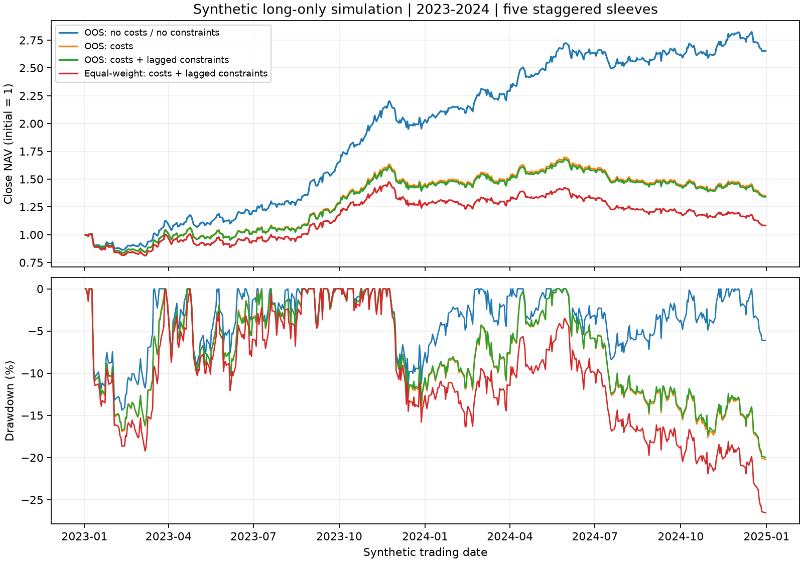

# Alpha Forensics：从因子时点审计到时间样本外资金回测

范围说明：此文件保留此前季度 HGB 的资金账本扩展记录。本轮新增年度 Ridge、HGB 及行业市值基准的统一比较见[组合回测报告](portfolio_backtest_report.md)，已纳入[正式研究报告](research_report.md)；两套实验的训练更新规则不同，结果不混用。

研究日期：2026-10-11。数据版本：Alpha Forensics v1.0。全部资产、行情和交易条件均为题目提供的匿名合成数据。

## 1. 研究判断

原研究的高预测相关性显著依赖尚未发布的因子快照。修正这一点后，再改用严格按时间训练和评价，模型仍保留一定截面排序信息，但表现较原报告明显减弱。

本轮进一步将预测转成五份资金轮换的做多组合，真实记录模拟中的现金、持仓、成本、未成交和退出损失。2023—2024 年，样本外模型在所列执行代理下累计收益 **34.12%**、年化收益 **15.26%**、日净值 Sharpe **0.74**、最大回撤 **19.99%**；同规则成员等权基准累计收益 **8.26%**。模型组合 2023 年收益 **41.63%**，2024 年为 **−5.30%**，不能据全期正收益推断逐年稳定。

当前证据支持保留该模型作为后续研究候选。成本敏感、2024 年绝对收益下降和开盘成交状态的不确定性，仍不支持直接推进策略应用。

## 2. 保留版本及研究边界

| 版本 | 数据与训练方式 | 用途与证据位置 |
|---|---|---|
| 原交接包 | 原因子快照、随机行切分、全量预测及五日收益差 | 题包 `baseline/`，全部原文件保留 |
| 原样重跑 | 在当前环境运行原训练和回测代码 | `outputs/model_rerun/original/` |
| 仅因子时点修正 | 修正 03/12 可用日期，保留同样本、原模型和原回测口径 | `outputs/factor_timing/`、`outputs/model_rerun/pit/` |
| 时间样本外模型 | 成熟标签、时间边界、逐季度扩展训练、无随机早停 | `outputs/temporal_oos/` |
| 日净值资金回测 | 完整当期成员信号、持仓与现金、双边成本、滞后交易许可 | `outputs/portfolio_upgrade/` |

复用了原研究的 20 个因子、五日开盘到开盘标签、HGB 模型家族与主要参数。新增模块负责时间划分、完整信号覆盖、自融资账本和独立核算。原始代码与此前结果未覆盖；文件校验记录见 `outputs/upgrade_audit.json`。

本轮回答三个问题：时间外预测能力剩多少；修正后的信号能否在明确的资金与交易假设下形成净收益；原报告指标与新结果应如何比较。本轮不训练其他算法，不进行超参数择优，不使用外部市场数据。

## 3. 时间验证：修复随机跨期与训练样本混入评价

### 3.1 固定方案

用 2021 年数据训练一个模型，评价 2022 年；2023—2024 年分别在每季度开始前，使用全部已经成熟的历史成员样本重新拟合，随后只预测该季度。每条预测都晚于该模型的训练截止时间。

训练冻结于预测期首个合成交易日前一工作日盘后，并要求训练标签的 `exit_date <= train_cutoff`。例如，2023 年第一季度模型在 2022-12-30 盘后冻结，最晚使用的训练参考日为 2022-12-22，其标签于 2022-12-30 开盘实现。跨入预测期才结束的训练标签被排除。

保留学习率 0.065、最多 17 叶、L2=0.2、种子 1021；显式关闭内部随机早停，固定训练 55 轮。时间验证模型使用 94,045 条成熟样本；八个样本外季度模型从 192,806 条逐渐增加至 369,454 条。九折均实际完成 55 轮，训练标签与预测时间边界检查通过。该方案改变了时间划分、训练量与内部早停，差值应理解为整套时间方案的结果。

### 3.2 不能让未来标签决定交易股票池

原处理流程只保留能算出未来五日收益的记录，会提前剔除资产退出前和样本期末的部分记录。新流程按信号日 `is_listed & is_member` 生成完整信号，只有训练和需要真实收益的诊断统计才筛选成熟、非缺失标签。

2023—2024 年共生成 **201,662 条信号、522 个日期**，其中 **2,340 条无法计算完整未来标签**，包括退出后的永久缺失和数据期末未覆盖的收益终点。这些记录保留用于交易决策；预测诊断在剩余 199,322 条、516 个日期上进行。旧模型与新模型的诊断交集完全一致，旧来源未匹配的有标签记录为 0。

### 3.3 相同日期和资产的预测诊断

以下均使用 2023—2024 年共同的 199,322 条记录。五日收益差是预测最高与最低十分位的后续收益差，不是日净值回报。

| 预测版本 | Pearson | RMSE | 平均日度 RankIC | 平均五日多空收益差 |
|---|---:|---:|---:|---:|
| 原输入＋随机切分的旧模型 | 0.303031 | 0.048447 | 0.388343 | 5.4444% |
| PIT 输入＋随机切分的旧模型 | 0.066392 | 0.050709 | 0.072875 | 1.0621% |
| PIT 输入＋时间样本外模型 | 0.015165 | 0.051161 | 0.059525 | 0.7658% |

前两行包含训练时期的信息，保留作历史对照，不称为时间样本外成绩。新模型 2023/2024 年的日均 RankIC 分别为 0.0693/0.0496，五日收益差分别为 0.8371%/0.6934%。2022 年时间验证的 RankIC 为 0.1688，后续年份明显减弱。没有对重叠五日标签使用独立日观测假设的显著性检验，也不把相关性直接解释成交易收益。

证据：`outputs/temporal_oos/comparison.csv`、`metrics.csv`、`fold_manifest.csv` 和 `predictions.csv.gz`。

## 4. 从五日收益差改成自融资日净值

题包未提供借券成本、可借数量或融资条件，资金账本采用**做多预测最高十分位**，以成员等权为基准。原多空收益差继续作为信号诊断保留。原代理 Sharpe 与新的做多日净值 Sharpe 在策略、样本及计量口径上均不同，不能作同一种指标的直接降幅比较。

### 4.1 下单、持仓和资金约定

本金归一为 1，分成五份各 0.2 的初始资金，每天轮到一份。t 日盘后用完整当期成员信号选股，采用预测值不低于当日 90% 分位数的规则，边界并列值全部保留。以该资金份当时净值确定含费预算；t+1 开盘先处理到期卖单，再等额买入原名单。每笔新仓正常在 t+6 开盘退出。各份资金独立再投资，之后并不强行恢复相等权重。

现金不足时统一缩减买入预算；禁买、无报价或同资产旧仓未售出的份额留在现金，不补选、不重分配。禁卖旧仓保留原到期日并每天重试，其他资产仍按计划交易。允许分数股，不融资，现金不计利息。

每笔实际买卖按前一交易日已知代理计费：单边手续费＋完整价差的一半＋冲击代理。各资金份到期卖出和新周期买入分别计成本，不进行同名买卖净额合并，等权基准也执行这一换仓规则。因此这里的基准是同频调仓组合，不是免成本市场指数；费用含完整五日轮换的成本。

可买卖状态采用前一日标记作为执行代理，当日最终标记只用于事后核查。资产首次缺报价时按零回收核销并逐笔记录，不跨退出填价、不预知退出日期提前卖出。固定最后入场信号日为 2024-12-23，终点为 2024-12-31；期末仍不能卖出的仓位按真实收盘价估值。

每日净值为现金加持仓收盘市值，日收益为相邻净值之比减一，初始本金纳入回撤和建仓费用。年化收益用 `NAV末值^(252/收益日数)-1`，Sharpe 用日收益均值除以样本标准差再乘 `sqrt(252)`，无风险利率取 0。本轮有 522 个净值点、521 个日收益。

### 4.2 相同策略的成本与约束分解

| 时间样本外做多组合 | 累计收益 | 年化收益 | 年化波动率 | 日净值 Sharpe | 最大回撤幅度 |
|---|---:|---:|---:|---:|---:|
| 不计交易成本、不加方向约束 | 165.22% | 60.29% | 22.92% | 2.17 | 14.38% |
| 加入交易成本 | 35.22% | 15.71% | 22.89% | 0.75 | 20.23% |
| 成本＋滞后方向约束 | **34.12%** | **15.26%** | **22.48%** | **0.74** | **19.99%** |
| 同成本与约束的成员等权基准 | 8.26% | 3.91% | 23.95% | 0.28 | 26.55% |

“不计交易成本”一行仍处理真实报价缺失，不等于忽略资产退出风险。净组合终值 1.34118，相对净基准终值 1.08260 的相对财富增幅为 **23.88%**。年收益按当年期末净值除以上年期末净值计算；2023 年从初始本金 1 开始：

| 年份 | 样本外净组合 | 同口径净基准 |
|---|---:|---:|
| 2023 | 41.63% | 26.27% |
| 2024 | −5.30% | −14.26% |

成本是这套五日轮换方案的主要约束。净组合日均双边换手约 38.79%；两年手续费、半价差和冲击成本累计分别为初始本金的 7.92%、15.01%、63.24%。这些累计现金扣款与净值复利差异不是同一个量，不能相加后直接当作年化成本率。

### 4.3 旧模型放入同一资金账本的对照

为避免原预测文件按未来标签过滤股票池，本轮恢复原模型并确认其原有记录预测逐点一致，再对完整当期成员补齐旧原版及旧 PIT 模型预测。以下三行均采用同一做多、成本、滞后约束和日期，但前两行仍然含前视或训练样本污染。

| 模型置于相同账本 | 累计收益 | 年化收益 | 日净值 Sharpe | 最大回撤幅度 | 证据性质 |
|---|---:|---:|---:|---:|---|
| 原输入＋随机模型 | 1548.90% | 287.92% | 5.76 | 9.85% | 受污染历史对照 |
| PIT 输入＋随机模型 | 60.13% | 25.57% | 1.11 | 16.95% | 非时间样本外对照 |
| PIT 输入＋时间样本外模型 | 34.12% | 15.26% | 0.74 | 19.99% | 逐时点模型样本外回放 |

这张表说明正确记账不会消除旧预测中的信息污染；原模型异常高收益不能成为可执行策略证据。完整八组结果及匹配基准列见 `outputs/portfolio_upgrade/portfolio_comparison.csv`。

## 5. 证据校验与仍未确认的条件

本轮新增 5 项时间模型测试及 11 项账本测试，均通过；此前相关测试也通过。独立审计不调用账本的更新逻辑，而从成交明细重新累积现金和持仓，用原始收盘价重新估值，复算收益与风险指标。共核对 **1,395,789 次订单尝试、1,390,738 笔成交**，八个账本最大净值误差约 **9.47×10⁻¹³**。原题包和此前结果哈希均未改变。

需要保留以下条件，避免把模拟结果解释过度：

1. **开盘成交未获日度数据证明。**主净组合 39,609 笔假设成交中有 291 笔与当日最终禁买卖标记冲突，约占 0.735%。前日许可不能证明次日开盘可以成交。这些冲突已逐笔保存，未用事后状态倒改订单。
2. **退出估值采用保守假设。**SIM0368 首次缺报价时，五份持仓发生五笔零回收核销，合计约初始本金的 4.03%。题包没有真实退出结算价，该项应视为估值假设损失。主组合期末无持仓，净等权基准仍有一笔约 0.000549 的持仓市值，已按终日收盘价保留。
3. **成本与容量仍是代理。**冲击是标准订单费率，不包含真实订单规模函数；每五日完整换仓且不净额合并，结果对换手和冲击假设敏感。
4. **属于历史回放。**2023—2024 年已在前期审计中被观察。本次冻结参数后得到的是按时间隔离的模型样本外结果，不能称从未触碰的新数据盲测；也未做行业、风格和风险中性后的收益归因。

建议后续优先核实开盘执行状态与退出结算，研究可实现的净额调仓和成本容量，再使用未参与当前分析的新样本验证。现在可以确认原高代理指标不足以支持应用，也可以保留“修正后仍有候选截面信号”的研究假设。

运行命令、输入输出位置和完整复核方式见 [升级运行说明](UPGRADE_README.md)。模型与数据元信息见各阶段 `run_manifest.json`；逐笔、逐日证据和独立核算见 `outputs/upgrade_audit.json`。
